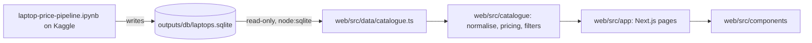

# Architecture

The repository has two parts that meet at one SQLite file:



| Part     | Path                          | Runtime                         | Owns                                                          |
| -------- | ----------------------------- | ------------------------------- | ------------------------------------------------------------- |
| Pipeline | `laptop-price-pipeline.ipynb` | Kaggle GPU T4 x2, Python        | scraping, extraction, LLM normalisation, matching, all writes |
| Web app  | `web/`                        | Node.js 22.13 or newer, Next.js | browsing, filtering and presenting the database, read-only    |

The database schema (described in [README.md](README.md#database)) is the contract between them. The web app never
writes to it.

## Web app modules

```text
web/src/
|-- app/                 Routes only: layout, browse page, laptop page, not-found, error
|-- data/catalogue.ts    The only module that touches SQLite and the filesystem (server-only)
|-- catalogue/           Pure domain logic, no I/O, shared by server and client
|   |-- specs.ts         The 42 canonical fields, their groups, labels and units
|   |-- types.ts         Laptop, Offer, PriceSummary and catalogue types
|   |-- normalise.ts     Folding seller spellings into filter labels; accessory exclusion
|   |-- pricing.ts       Headline price choice, discounts, offer order
|   |-- filters.ts       Filter definitions, URL parsing, matching, facet counts, sorting, paging
|   |-- url-state.ts     URLSearchParams edits used by the filter controls; page number list
|   |-- summary.ts       Key specs (processor, memory, storage, graphics, display, weight) for cards and summaries
|   `-- format.ts        Currency, dates, ages, spec values, provenance text
`-- components/
    |-- ui/              Generic accessible controls (checkbox, switch, range, select)
    |-- browse/          Browse page pieces
    `-- laptop/          Laptop page pieces
```

Dependency rules:

- `catalogue/` imports nothing outside itself.
- `data/` imports `catalogue/`; nothing on the client imports `data/` (enforced by the `server-only` import).
- `components/ui/` imports only `catalogue/` helpers and has no knowledge of pages.
- `components/browse/` and `components/laptop/` import `catalogue/` and `components/ui/`; `browse` uses
  `laptop/PriceNote` for the shared price wording.
- `app/` composes `data/`, `catalogue/` and `components/`.

## Request flow

1. `getCatalogue()` reads the whole catalogue in one read-only connection: products with specs and lowest prices,
   offers from the `v_current_offers` view, sites, the latest run and open match candidates. It caches the result
   until the database file changes or 5 minutes pass (offer freshness depends on the current time).
2. The browse page parses query parameters into a `FilterState`, then `browse()` filters, counts facets, sorts and
   pages in memory.
3. Client controls edit the URL with `url-state.ts` and navigate with `router.replace` inside a transition; the
   server renders the new results.

## Where new code goes

- A new filter: one entry in `FILTERS` in `catalogue/filters.ts`. The URL parameter, panel control, chips and counts
  follow from it.
- A new canonical field: add it to `SPEC_GROUPS` and `SPEC_META` in `catalogue/specs.ts` after the pipeline adds the
  column to `product_specs`.
- A new label normalisation: `catalogue/normalise.ts`, with a test case in `normalise.test.ts`.
- A new query against the database: `data/catalogue.ts` only.
- A new page: a route folder in `app/`, with its components in a matching `components/<feature>/` folder.

## Decisions

- **Next.js App Router with server components.** Filtering and the database stay on the server; only interactive
  controls ship to the browser.
- **`node:sqlite` instead of a driver package.** Node.js 22.13 and newer include SQLite, so there is no native module
  to build. It needs Node.js 22.13 or newer (pinned in `.nvmrc` and `engines`).
- **Whole catalogue in memory.** The pipeline adds at most 30 new product URLs per site per run, so the catalogue
  grows slowly (105 laptops after the last run). Filtering in memory avoids an index per filter and keeps facet counts exact.
- **npm workspaces.** One root lockfile; the root scripts delegate to `web/`.
- **One launcher.** `npm run dev` runs `scripts/dev.mjs`, which installs on the first run or when the lockfile
  changes, checks the port, starts `next dev` and opens the browser.

## Allowed duplication

- The notebook stays self-contained (Kaggle requirement); the web app reads its output rather than sharing code.
- The 42 field names exist in the notebook's schema and in `catalogue/specs.ts`. They are a published database
  contract that cannot share code across Python on Kaggle and TypeScript.
- `PriceSummary.kind` mirrors the notebook's comparable-offer rule (`run_price_aggregation`), but only reads its
  result from `lowest_prices`; the web app adds fallbacks for products the pipeline did not compare.

## Growth signals

- More than a few thousand laptops, or response times above about 200 ms: move filtering into SQL with indexes on
  filtered columns, or precompute facets after each pipeline run.
- Several pipeline runs a day: replace the time-based cache with a signal from the pipeline (for example the latest
  `scrape_runs.finished_at`).
- A second consumer of the database: move the reading code into its own package with the schema types.
