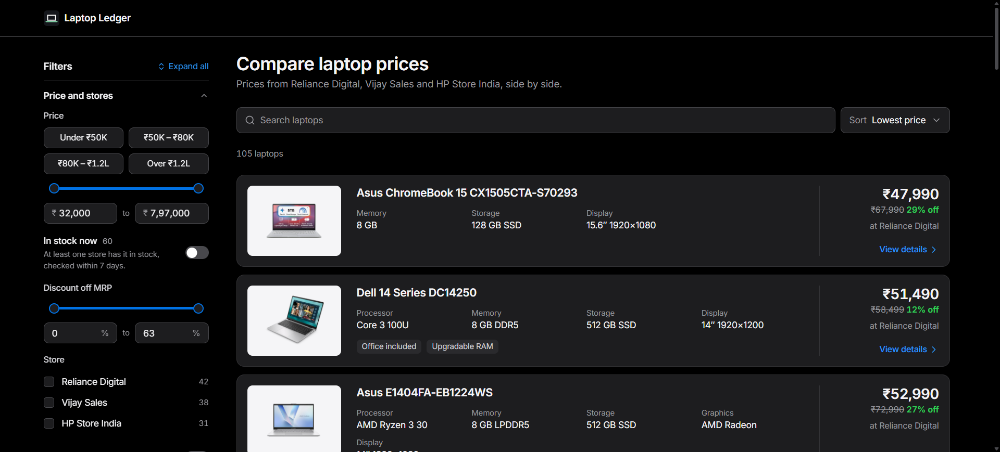
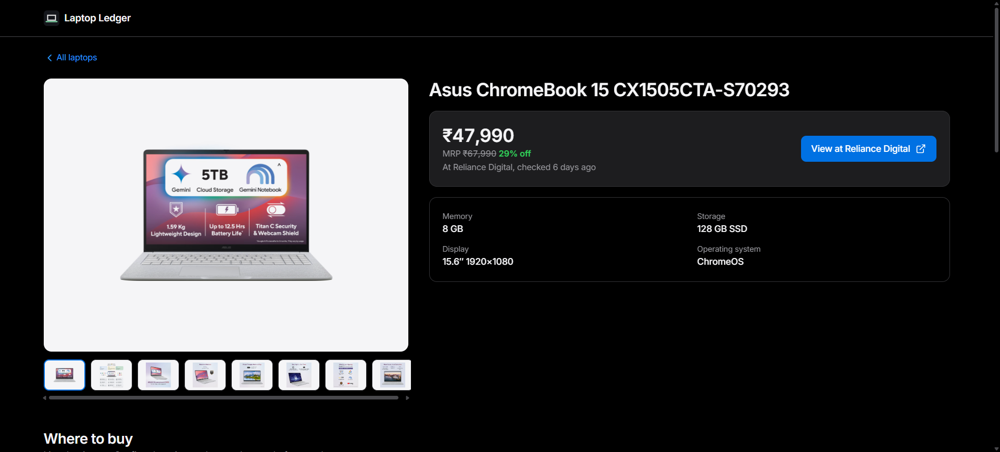
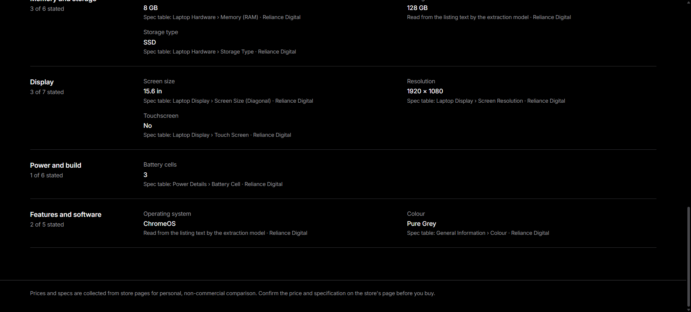
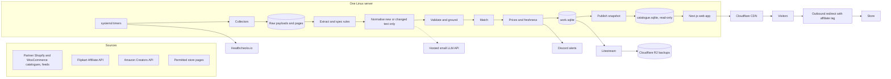

# Proposal: a self-operating laptop catalogue for PickPCParts

This document proposes how the prototype in this repository could become an automated, low-cost data service for the
[PickPCParts laptop section](https://laptops.pickpcparts.in/). It separates what the prototype already does (verified
against the code and the committed run outputs) from what is proposed, gives cost estimates in INR with their
assumptions, and explains the trade-offs behind each choice.

Written on 2026-10-15. Prices, free tiers and API terms change often; each external fact below carries the date it was
read and a source in [RESEARCH.md](RESEARCH.md#pickpcparts-deployment-hosting-apis-and-costs-2026-10-15).

Companion documents:

| Document                                     | Covers                                                                           |
| -------------------------------------------- | -------------------------------------------------------------------------------- |
| [docs/DATA_SOURCES.md](docs/DATA_SOURCES.md) | Amazon, Flipkart, partner stores and page collection: access, limits, cost, risk |
| [docs/COSTS.md](docs/COSTS.md)               | Monthly cost model, alternatives compared, affiliate revenue and break-even      |
| [docs/OPERATIONS.md](docs/OPERATIONS.md)     | Deployment, configuration, schedules, monitoring, backups, security, runbooks    |
| [ARCHITECTURE.md](ARCHITECTURE.md)           | Module layout of the current web app                                             |
| [README.md](README.md)                       | The prototype: pipeline, web app, evaluation results, local checks               |

## Contents

- [Summary](#summary)
- [Context and constraints](#context-and-constraints)
- [What the prototype does today](#what-the-prototype-does-today)
- [Proposed architecture, end to end](#proposed-architecture-end-to-end)
- [Automation](#automation)
- [Scalability](#scalability)
- [Decisions and trade-offs](#decisions-and-trade-offs)
- [Roadmap](#roadmap)
- [Risks](#risks)
- [Questions for the PickPCParts team](#questions-for-the-pickpcparts-team)

## Summary

- **What exists.** A working prototype: a pipeline that collects laptop listings from Reliance Digital, Vijay Sales
  and HP Store India, turns each into a 42-field specification with per-field provenance, matches identical
  configurations across stores and stores everything in one SQLite file; and a Next.js web app (Laptop Ledger) that
  compares prices from that file. Measured on 29 hand-labelled listings: field accuracy 0.988, matching precision 1.0.
- **What is missing for production.** The pipeline runs by hand as a Kaggle GPU notebook. There is no scheduler, no
  retailer API or partner feed integration, no affiliate tagging of outbound links and no deployment setup. Two of the
  three prototype sources restrict automated or commercial use (see [Data sources](docs/DATA_SOURCES.md)).
- **The proposal.** Keep the architecture small: one Linux server (ideally the server PickPCParts already runs) with
  scheduled jobs, SQLite with continuous backups to free object storage, the existing web app behind the Cloudflare
  CDN that PickPCParts already uses, and a hosted small language model used only for new or changed listings.
  Prefer data that stores give willingly (partner catalogues and feeds, the Flipkart and Amazon affiliate APIs) over
  page collection.
- **Partner stores.** 52 of PickPCParts' 65 partner stores run Shopify or WooCommerce with a public product endpoint
  (checked 2026-10-15). With each store's consent, two generic collectors could keep their prices and stock current
  with no per-store code. Only 8 of them sell laptops, so the larger gain is for the component and peripheral
  catalogue. See [docs/DATA_SOURCES.md](docs/DATA_SOURCES.md#partner-stores).
- **Cost.** About ₹25 to ₹100 a month on top of current spending if the existing server has spare capacity, or
  about ₹700 to ₹800 a month with a dedicated small server. The main cost is volunteer engineering time, not
  infrastructure. Details in [docs/COSTS.md](docs/COSTS.md).
- **Capacity.** The current web app served about 13 to 15 requests a second from one Node.js process with a
  synthetic 3,150-laptop catalogue (measured, see [Scalability](#scalability)); 100,000 visits a month need well
  under 1 request a second on average.

## Context and constraints

Facts given by the PickPCParts team on Discord (as relayed by the author; not independently verified):

- PickPCParts is a community platform funded mainly by affiliate links, with earnings reinvested in running it.
- It costs about ₹10,000 a month to operate after cost-saving measures. The breakdown of that figure is not known
  here.
- It receives about 100,000 visits a month, growing quickly.
- It works with more than 65 Indian retailers. Data collection, price updates and maintenance are largely manual.
- The laptop section is under active development.

Observed on 2026-10-15: `pickpcparts.in` and `laptops.pickpcparts.in` both answer through Cloudflare (`Server:
cloudflare`) and report `Via: 1.1 Caddy`, so the origin appears to be a self-managed server running the Caddy web
server. The main site is WordPress (its robots.txt and links point to `/wp-admin/` and `wp-content`), and its home
page carries placements labelled "Sponsored" alongside Amazon affiliate links. Nothing else about their stack is
assumed here.

The 65 partner stores were named by the team on 2026-10-15; their websites come from the
[PickPCParts retailer directory](https://pickpcparts.in/retailers/).

Constraints this proposal is designed against:

1. No new recurring cost unless its benefit clearly exceeds it. Free tiers are used only where their terms allow a
   site that earns affiliate revenue.
2. Less manual work, not different manual work. Every automated step must report its own failures.
3. Simple to run for volunteers: few moving parts, open-source components, no paid licences.
4. Every displayed price and specification must be traceable to a source and a time.
5. No bypassing of bot protection, and no collection a store's terms forbid.

### Verifiable goals

| Goal | Target                                                                                          | How it is checked                                                       |
| ---- | ----------------------------------------------------------------------------------------------- | ----------------------------------------------------------------------- |
| G1   | No manual price entry for any store connected through a feed, API or permitted collector        | Count of offers whose `last_verified_at` comes from an automated job    |
| G2   | Incremental infrastructure cost at most ₹1,000 a month at 10 times current traffic              | Monthly bills; [docs/COSTS.md](docs/COSTS.md)                           |
| G3   | Prices from feeds and APIs no older than 24 hours; from page collection no older than 7 days    | `v_current_offers.freshness`, `lowest_prices.price_age_hours`           |
| G4   | Every job failure produces an alert within one schedule interval                                | Healthchecks.io missed-ping alerts; `alerts` table forwarded to Discord |
| G5   | Extraction quality does not fall below the prototype's measured baseline (final accuracy 0.988) | Evaluation on `fixtures/ground_truth.json` in CI                        |

### Two ways to read the request

- **A standalone laptop data service** (assumed here). The pipeline owns a SQLite catalogue and the Laptop Ledger app
  serves `laptops.pickpcparts.in`. Other parts of PickPCParts can read the same file or a JSON export.
- **A module inside the existing PickPCParts backend.** Possible, but it depends on a stack this document cannot see.
  The data model and jobs below carry over; the web app would be replaced by their own pages.

## What the prototype does today

Verified against this repository on 2026-10-15. Numbers come from Kaggle run `20261009T192530Z` (files in
[`outputs/`](outputs/)) unless stated otherwise.

_Browse page of the Laptop Ledger web app on the committed database: 105 laptops, filters with counts, budget
presets, and each card's lowest price with MRP and discount._

| Capability                                                                              | Evidence                                                                             |
| --------------------------------------------------------------------------------------- | ------------------------------------------------------------------------------------ |
| Polite collection: robots.txt (RFC 9309), 6 s+ per host, retries, circuit breaker       | Notebook section 5; [README](README.md#how-it-works)                                 |
| Incremental fetching: 20-hour refresh window, conditional GET, resumable stages         | Notebook sections 2.2 and 10; `REFRESH_AFTER_HOURS`                                  |
| Site adapters for Reliance Digital, Vijay Sales, HP Store India                         | 113 listings extracted, 1,859 rule values (`outputs/metrics/run_summary.json`)       |
| 42-field canonical schema with per-field provenance                                     | `outputs/schema/laptop_schema.json`; `product_specs.field_sources_json`              |
| Rules first, then a local LLM (K2 Horizon 3.7B) with constrained decoding and grounding | Final accuracy 0.9881, hallucination rate 0.020 on 756 labelled cells                |
| Deterministic cross-store matching with a review queue                                  | Precision 1.0, recall 0.857 on 406 pairs; `match_candidates`, `match_reviews` tables |
| Price history, freshness labels, lowest comparable price                                | `price_history`, `v_current_offers`, `lowest_prices` (56 of 107 products priced)     |
| Health checks and alerts per run                                                        | `alerts`, `run_metrics`, `outputs/metrics/health.json` (no alerts in the last run)   |
| Web app: 42 filters, search, sort, store comparison, spec provenance                    | `web/src`; 56 unit tests and a production build pass in `npm run check`              |
| CI for the web app                                                                      | `.github/workflows/web.yml`                                                          |

_Laptop page: the headline price with MRP, discount, store and check age, a button to the store, key specs and the
product gallery._

_Spec sheet: each stated value names its source (a spec-table key or the extraction model) and the store; groups say
how many of their fields the stores state._

What the prototype does **not** do (verified absences):

- No scheduler. Each run is started by hand on Kaggle ("Save & Run All") and the database is copied into the repo.
- No retailer API, affiliate API or partner feed adapter. No credentials are configured anywhere.
- No affiliate tagging or click counting. Store links go directly to the product page
  (`web/src/components/laptop/OffersTable.tsx`).
- No admin interface. Match reviews are SQL `INSERT`s into `match_reviews`.
- No deployment configuration (no Dockerfile, process manager, reverse proxy or CDN settings).
- The Python pipeline exists only as the notebook. The local test harness described in the README
  (`.agent-local/scripts/test_pure_cells.py`) is not committed, so a fresh clone cannot run those checks.
- Only two retailers and one manufacturer store, chosen for a personal, non-commercial prototype.

## Proposed architecture, end to end

| Component            | Technology                                                        | Status                                                                          |
| -------------------- | ----------------------------------------------------------------- | ------------------------------------------------------------------------------- |
| Collectors           | Python; the notebook's `PoliteFetcher` and adapters               | Page collection exists; platform catalogue, feed and API collectors are **new** |
| Raw store            | gzip files addressed by SHA-256, plus `pages` and `extractions`   | **Exists**; retention policy is **new**                                         |
| Extraction and rules | Site adapters, 46 spec rules                                      | **Exists**; a generic feed mapper is **new**                                    |
| Normalisation        | K2 Horizon 3.7B on Kaggle T4 x2                                   | **Exists**; a hosted model behind the same validator is **proposed**            |
| Validation, matching | Schema validator, grounding, conflict checks, deterministic match | **Exists**                                                                      |
| Prices and freshness | `v_current_offers`, `lowest_prices`                               | **Exists**                                                                      |
| Database             | SQLite (standard library)                                         | **Exists**; WAL mode, publish step and Litestream are **new**                   |
| Scheduler            | systemd timers (or cron)                                          | **New**                                                                         |
| Web app              | Next.js 16, `node:sqlite`, read-only                              | **Exists**; outbound redirect, cache headers and review page are **new**        |
| CDN                  | Cloudflare free plan (already in front of PickPCParts)            | **New for this app**                                                            |
| Monitoring           | `alerts`, `run_metrics` tables                                    | **Exists**; Healthchecks.io pings and Discord forwarding are **new**            |

### Stage by stage

1. **Schedule.** systemd timers start each job (table in [Automation](#automation)). Each job is a short-lived
   process, so a crash cannot leave a daemon in a bad state, and the next timer run retries.
2. **Collect.** One collector per source type: feed download (one HTTP request per partner per run), affiliate API
   client (paged, with the provider's limits), and the existing polite page fetcher. Every response is stored raw
   before parsing, so a parser fix can be replayed without fetching again.
3. **Extract.** Feed rows and API records map field-by-field to the listing and price tables. Pages go through the
   existing adapters and spec rules. Rules are exact where they fire (precision 1.0 in the last run) and cost
   nothing to run.
4. **Normalise.** Only listings whose LLM input text hash is new are sent to a model; the prototype already caches by
   input hash and versions. The hosted model fills the fields rules did not; the existing validator and grounding
   step then null any value that is not supported by the text.
5. **Validate.** Existing checks: schema ranges and enums, grounding, source conflicts, price signal flags (stock
   contradictions, MRP discounts above 50%). Proposed addition: hold a price that moved more than 40% since the last
   observation until a second fetch confirms it.
6. **Match.** The existing deterministic matcher groups listings by brand plus model number or part number with
   compatible critical specs. Feeds that carry GTIN or MPN make this more reliable. Uncertain pairs go to the review
   queue, never auto-merged.
7. **Price.** Lowest comparable price per product among new, in-stock offers verified within 7 days, with its age.
8. **Publish.** The pipeline writes to `work.sqlite`. At the end of a successful run it writes a compact copy with
   `VACUUM INTO` and renames it over `catalogue.sqlite`. The web app already reloads when the file's modification
   time or size changes, so visitors never see a half-written run.
9. **Serve.** The web app reads `catalogue.sqlite` read-only. Cloudflare caches pages for a few minutes, so most
   visits never reach the server. (Today every page is sent with `Cache-Control: private, no-cache, no-store`, so
   this needs a Cloudflare Cache Rule; verified on 2026-10-15.)
10. **Monetise and measure.** Outbound store links go through a small redirect route that appends the store's
    affiliate parameters and counts the click. Click counts drive which prices are refreshed first and show which
    sources earn.
11. **Monitor.** Every job pings Healthchecks.io on success; a missed ping alerts. New rows in `alerts` are posted to
    a Discord channel. Litestream streams database changes to Cloudflare R2.

### Data model changes (proposed)

The current schema (README, [Database](README.md#database)) carries over. Proposed additions:

| Table or column                | Purpose                                                                                               |
| ------------------------------ | ----------------------------------------------------------------------------------------------------- |
| `sites.source_type`            | `shopify`, `woocommerce`, `feed`, `api` or `pages`; drives which collector and freshness target apply |
| `sites.affiliate_template`     | URL template or parameter for the store's affiliate programme                                         |
| `sites.permission_note`        | Who granted access, when, and on what terms                                                           |
| `outbound_clicks`              | Listing, time, coarse referrer page; no personal data or IP addresses                                 |
| `seller_listings.gtin`, `.mpn` | Identifiers from feeds and APIs, used by matching                                                     |
| `price_holds`                  | Price changes waiting for confirmation by a second fetch                                              |

## Automation

| Manual task today                     | Automated replacement                                                 | Trigger                    | Human involvement                       |
| ------------------------------------- | --------------------------------------------------------------------- | -------------------------- | --------------------------------------- |
| Updating prices store by store        | Feed and API collectors; page refresh oldest-first                    | Timer (see below)          | None                                    |
| Adding new laptops                    | Discovery from feeds, API category listings and sitemaps              | Daily timer                | None                                    |
| Typing specifications                 | Spec rules, then the LLM for remaining fields, with grounding         | New or changed listing     | None; low-confidence values stay `null` |
| Linking the same laptop across stores | Deterministic matcher                                                 | After every extraction run | Review queue for uncertain pairs only   |
| Spotting wrong prices                 | Price signal flags, price holds, stale and delisted labels            | Every run                  | Only when an alert fires                |
| Noticing a broken store integration   | Extraction failure rate and empty discovery alerts (already computed) | Every run                  | Fix the adapter when alerted            |
| Checking that jobs ran                | Healthchecks.io dead-man pings                                        | Missed schedule            | Only when an alert fires                |
| Backups                               | Litestream to R2, daily snapshot                                      | Continuous and daily       | Quarterly restore test                  |
| Affiliate links                       | Redirect route appends the programme's parameters                     | Each click                 | Add a template when joining a programme |

Proposed schedule (times IST; adjust to the stores' quiet hours and permissions):

| Job             | Frequency            | What it does                                                                                                                      | Typical run time (estimate)                                               |
| --------------- | -------------------- | --------------------------------------------------------------------------------------------------------------------------------- | ------------------------------------------------------------------------- |
| `feeds`         | Every 6 hours        | Read partner catalogues (Shopify, WooCommerce) and feeds, and API delta feeds; extract; normalise new text; match; price; publish | Up to about 15 minutes (largest WooCommerce partner: 122 requests at 6 s) |
| `pages-hot`     | Every 6 hours        | Refresh page-collected offers with the most clicks in 7 days (at most 50 per host)                                                | 5 to 10 minutes at 6 s per request                                        |
| `pages-daily`   | Daily, 02:00         | Refresh remaining page offers oldest-first within per-host caps; discovery of new URLs                                            | 30 to 40 minutes per host, in parallel                                    |
| `review-digest` | Weekly               | Post open `match_candidates` and flagged prices to Discord                                                                        | Seconds                                                                   |
| `snapshot`      | Daily, 04:00         | `VACUUM INTO` a dated snapshot, upload to R2, prune raw pages past retention                                                      | Seconds to minutes                                                        |
| `evaluate`      | On every code change | Run the fixture evaluation in CI; fail if accuracy drops below the baseline                                                       | Minutes, in GitHub Actions                                                |

The run times are estimates from the prototype's measured costs: about 43 ms of CPU per listing for extraction
(113 listings in 4.9 s), 0.1 s for matching and 0.2 s for prices, and 6 to 8 s between requests to one host.

What stays human, deliberately:

- Approving uncertain matches (2 open pairs in the last run). A wrong merge shows a wrong price; a missed merge only
  shows two cards.
- Adding a store: reading its terms or getting permission, then adding a feed URL or an adapter.
- Responding to alerts. Automation reports; it does not guess fixes.

## Scalability

### Measured

Measured on 2026-10-15 with `scripts/bench-web.mjs` against `next start` (production build), Node.js 24.15.0, Windows
11, Intel Core i7-9750H, one Node.js process, no CDN. Each run rotated through the browse page, a search with sort,
page 3 of the results and one laptop page for 20 seconds.

| Catalogue                                    | Concurrent requests | Requests per second | p50 latency | p95 latency | Server memory (working set) |
| -------------------------------------------- | ------------------- | ------------------- | ----------- | ----------- | --------------------------- |
| 105 laptops (committed database)             | 1                   | 52.7                | 19 ms       | 33 ms       | about 170 MB                |
| 105 laptops                                  | 8                   | 57.0                | 135 ms      | 189 ms      |                             |
| 3,150 laptops (30 copies of each, synthetic) | 1                   | 13.4                | 76 ms       | 150 ms      | about 420 MB                |
| 3,150 laptops                                | 8                   | 15.4                | 509 ms      | 644 ms      |                             |

The synthetic catalogue is built by `scripts/scale-catalogue-db.mjs`. It repeats real products, so filter and facet
work is realistic, but search results are denser than in a real catalogue. A server CPU will differ from this laptop;
run the same script on the target server before relying on these numbers.

Page sizes from the same build: the browse page is 172 KB of HTML (17.6 KB gzipped), a laptop page 51 KB.

### What the traffic needs

Assumptions: all 100,000 monthly visits reach the laptop section, each visit views 3 pages, and the busiest hour
carries 20 times the average rate. Then:

- average: 300,000 page views a month, about 0.12 requests a second;
- peak: about 2.3 requests a second.

One Node.js process handled 13 to 15 requests a second at 3,150 laptops without any CDN cache, so the current
design covers about 6 times that assumed peak at 30 times today's catalogue, and far more at today's catalogue size.

### Growth path

Each step is taken only when its signal appears; none needs a bigger bill until the last.

| Signal                                                  | Change                                                                                                                                                      | Extra cost                     |
| ------------------------------------------------------- | ----------------------------------------------------------------------------------------------------------------------------------------------------------- | ------------------------------ |
| Any public launch                                       | Cache HTML at Cloudflare for 5 minutes with a Cache Rule (the app sends `private, no-store` today; see [docs/OPERATIONS.md](docs/OPERATIONS.md#cloudflare)) | ₹0                             |
| Peak load above about 5 requests a second at the origin | Run two `next start` processes behind Caddy (load balancing is built in)                                                                                    | ₹0                             |
| More than about 10,000 laptops, or p95 above 200 ms     | Move filtering and facet counts into SQL with indexes, or precompute facets in the publish step (see ARCHITECTURE.md)                                       | ₹0                             |
| Search quality complaints                               | SQLite FTS5 full-text index built in the publish step                                                                                                       | ₹0                             |
| Sustained origin CPU above 70%                          | Next server size up (for example 2 to 4 vCPU)                                                                                                               | Roughly ₹700 to ₹1,500 a month |
| Several writers, or other services need live writes     | PostgreSQL on the same server                                                                                                                               | ₹0 extra on the same server    |

### Data volume

| Item                       | Measured in the prototype                         | At 6,000 listings (assumption)                                                                                        |
| -------------------------- | ------------------------------------------------- | --------------------------------------------------------------------------------------------------------------------- |
| Database                   | 2.9 MB for 113 listings (about 26 KB per listing) | About 160 MB, plus price observations                                                                                 |
| Price observations         | One row per listing and page version              | Under 100 MB a year if a row is written only when price or stock changes                                              |
| Raw HTML                   | 13.4 MB gzipped for 113 pages (about 120 KB each) | About 10 GB if every page version were kept 14 days; so keep a page only when its extraction changed, and for 30 days |
| Download per daily refresh | Pages average about 1.7 MB uncompressed           | About 0.7 GB a day if served gzipped; feeds and APIs need far less                                                    |

## Decisions and trade-offs

| Decision              | Chosen                                                                                                | Alternatives considered                                              | Why                                                                                                                                                                                             |
| --------------------- | ----------------------------------------------------------------------------------------------------- | -------------------------------------------------------------------- | ----------------------------------------------------------------------------------------------------------------------------------------------------------------------------------------------- |
| Where data comes from | Partner platform catalogues and feeds, and affiliate APIs first; page collection only where permitted | Collect every store's pages                                          | Structured sources rarely break and carry permission; 52 of 65 partners need no per-store code. Pages break when layouts change and several stores' terms forbid it.                            |
| Database              | SQLite, one writer, read-only web app                                                                 | Managed PostgreSQL, Cloudflare D1                                    | Already the contract between pipeline and app; no server to run; one file to back up. A single scheduled writer is SQLite's strong case.                                                        |
| Hosting               | One small Linux server, preferably PickPCParts' own                                                   | Vercel, Cloudflare Workers, Oracle Always Free                       | Vercel's Hobby plan forbids sites whose primary purpose is affiliate linking; Workers needs a rewrite away from `node:sqlite`; Oracle's free allowance was halved in 2026 and can change again. |
| Job orchestration     | systemd timers running short processes                                                                | Celery or a queue with Redis, Airflow, GitHub Actions cron           | No extra service to monitor. GitHub Actions is a fallback, but its runners' cloud IPs are more likely to be blocked by stores.                                                                  |
| LLM normalisation     | Hosted small model, only for new or changed text                                                      | K2 Horizon on Kaggle (free, manual), a local CPU model, a rented GPU | At the measured 2,200 input tokens per listing it costs about ₹0.05 a listing, and it can be scheduled. Kaggle stays useful for evaluation. A GPU is not needed in production.                  |
| Rendering             | Server rendering with CDN caching                                                                     | Static export with client-side filtering                             | Keeps the current, tested app. A static export is a good later option if the origin must go (see Roadmap).                                                                                      |
| Backups               | Litestream to R2, plus daily snapshots                                                                | Provider snapshots, nightly copy only                                | Continuous, open source (Apache-2.0), and within R2's 10 GB free tier.                                                                                                                          |

## Roadmap

Impact: H high, M medium, L low. Complexity: S days, M one or two weeks, L more, for one volunteer. Ongoing cost is
monthly.

### Implemented in the prototype

Everything in [What the prototype does today](#what-the-prototype-does-today): polite collection for three sources,
42-field extraction with provenance, LLM normalisation with grounding, matching with a review queue, freshness and
lowest prices, run health checks, and the Laptop Ledger web app with CI.

### Phase 0: decisions and permissions (no code)

| #   | Item                                                                                                                             | Impact | Complexity | Ongoing cost |
| --- | -------------------------------------------------------------------------------------------------------------------------------- | ------ | ---------- | ------------ |
| 0.1 | Share the current ₹10,000 breakdown and server spare capacity (CPU, RAM, disk)                                                   | H      | S          | ₹0           |
| 0.2 | Ask the 52 Shopify and WooCommerce partners for consent to read their public catalogue, and the other 13 for a product feed      | H      | S          | ₹0           |
| 0.3 | Check Flipkart Affiliate API access and Amazon Creators API eligibility for amazon.in                                            | H      | S          | ₹0           |
| 0.4 | Decide which prototype sources stay, based on permission (Vijay Sales terms forbid commercial use)                               | H      | S          | ₹0           |
| 0.5 | Share anonymised affiliate numbers (clicks, conversion, commission) to replace the assumptions in [docs/COSTS.md](docs/COSTS.md) | M      | S          | ₹0           |

### Phase 1: a minimum self-operating service

| #   | Item                                                                                                                                                    | Impact | Complexity | Ongoing cost                         |
| --- | ------------------------------------------------------------------------------------------------------------------------------------------------------- | ------ | ---------- | ------------------------------------ |
| 1.1 | Move the notebook's deterministic stages into a Python package with a command line, and commit the fixture tests in CI                                  | H      | M          | ₹0                                   |
| 1.2 | Generic collectors for Shopify `/products.json`, the WooCommerce Store API and Merchant Center or CSV feeds (covers 52 partners without per-store code) | H      | S to M     | ₹0                                   |
| 1.3 | Hosted LLM normaliser behind the existing validator; accept only if it matches the baseline on the 29 fixtures                                          | H      | S          | About ₹25 to ₹100                    |
| 1.4 | systemd timers, publish step, Litestream to R2, Healthchecks.io pings, Discord alert forwarding                                                         | H      | S          | ₹0                                   |
| 1.5 | Outbound redirect route with affiliate parameters and click counts                                                                                      | H      | S          | ₹0                                   |
| 1.6 | Deploy the web app behind Caddy and Cloudflare with cache headers                                                                                       | M      | S          | ₹0 or about ₹660 (own server or not) |

### Phase 2: more sources and less review

| #   | Item                                                                                | Impact | Complexity | Ongoing cost |
| --- | ----------------------------------------------------------------------------------- | ------ | ---------- | ------------ |
| 2.1 | Flipkart Affiliate API collector (product and delta feeds)                          | H      | M          | ₹0           |
| 2.2 | Amazon Creators API collector, once eligible                                        | H      | M          | ₹0           |
| 2.3 | Review page for match candidates and price holds, behind Caddy basic authentication | M      | M          | ₹0           |
| 2.4 | Price holds for sudden changes; price history chart on the laptop page              | M      | S          | ₹0           |
| 2.5 | `sitemap.xml`, page metadata and structured data for search engines                 | M      | S          | ₹0           |
| 2.6 | Click-weighted refresh order for page-collected offers                              | M      | S          | ₹0           |

### Future enhancements

| #   | Item                                                                                                                                                           | Impact | Complexity | Ongoing cost |
| --- | -------------------------------------------------------------------------------------------------------------------------------------------------------------- | ------ | ---------- | ------------ |
| 3.1 | Price-drop alerts through Discord, RSS or web push (no paid email service)                                                                                     | M      | M          | ₹0           |
| 3.2 | Community price reports that enter the review queue                                                                                                            | M      | M          | ₹0           |
| 3.3 | Reuse the collectors and matching for the main component and peripheral catalogue, where most partner products are; then other schemas (monitors, peripherals) | H      | M to L     | Same server  |
| 3.4 | SQL-side filtering or precomputed facets, FTS5 search                                                                                                          | M      | M          | ₹0           |
| 3.5 | Static export with client-side filtering on a static host, if the origin server must go                                                                        | L      | L          | ₹0           |
| 3.6 | Benchmark and power-limit data, if a source with permission appears                                                                                            | M      | M          | Unknown      |

## Risks

| Risk                                                      | Likelihood               | Effect                                 | Mitigation                                                                                       |
| --------------------------------------------------------- | ------------------------ | -------------------------------------- | ------------------------------------------------------------------------------------------------ |
| A store changes its page layout                           | High for page collection | Missing or wrong fields for that store | Extraction failure alerts; stored raw pages allow replay after a fix; prefer feeds               |
| A store blocks the server's IP or changes its terms       | Medium                   | Stale prices for that store            | Stale labels after 7 days; never bypass; move that store to a feed or drop it                    |
| Amazon or Flipkart API access is withdrawn or not granted | Medium                   | No prices from that marketplace        | Link to the marketplace search without a price, as many comparison sites do                      |
| Free tier terms change (as Oracle's did in 2026)          | Medium                   | Unexpected bill or shutdown            | Prefer the existing server; keep everything portable (one SQLite file, standard Linux)           |
| LLM extracts a wrong value                                | Low to medium            | Wrong spec shown                       | Rules first, grounding, provenance shown to users, CI evaluation against fixtures                |
| Volunteer time runs out                                   | Medium                   | Integrations decay                     | Few components, runbooks in [docs/OPERATIONS.md](docs/OPERATIONS.md), alerts that say what broke |

## Questions for the PickPCParts team

1. What does the ₹10,000 a month pay for, and does the current server have about 1 GB of RAM and some CPU to spare?
2. Will the partner stores agree to their public Shopify or WooCommerce catalogue being read every few hours, and can
   the other 13 send a product feed (for example the one they make for Google Shopping)?
3. Does PickPCParts already have Flipkart and Amazon affiliate accounts, and roughly how many referred sales a month
   come from Amazon.in? (The Creators API asks for 10 qualifying sales in 30 days.)
4. Should the laptop section stay a separate app at `laptops.pickpcparts.in`, or should the data feed the main site?
5. Who will review uncertain matches, and is a weekly Discord digest the right channel?
