# Laptop Price and Specification Pipeline

A Kaggle notebook pipeline that collects laptop listings from two Indian retailers and HP's India store, keeps every
raw page for traceability, and turns each listing into a strict 42-field canonical record. The record covers identity,
processor with its configured power limit, memory, graphics with VRAM and TGP, display, battery, adapter, weight,
thickness, cooling, Wi-Fi and software. Values come from deterministic spec-table rules first, and the locally run
[K2 Horizon 3.7B](https://huggingface.co/IFM/K2-Horizon-3.7B) model fills the rest. The pipeline then matches identical
configurations across sellers and loads everything into SQLite with price history, per-field provenance, freshness
labels, run metrics, alerts and the lowest current comparable price per exact configuration.

Status:

- The previous notebook version (21-field schema, two retailers) ran end to end on Kaggle on 2026-10-09 (run
  `20261009T175113Z`). Its outputs are in [`outputs/`](outputs/) and are reported in
  [Results of the last Kaggle run](#results-of-the-last-kaggle-run-previous-version). They exposed a decoder bug that
  made every numeric field `null`, plus false source conflicts. Both are fixed in the current version.
- The current version (42 fields, three sources, rules, freshness, monitoring) has **not been run on Kaggle yet**.
- The deterministic stages of the current version were tested locally:
  - against 29 real page snapshots: parsing, rule extraction, prices, conflicts, grounding, matching, views, migration
    and resume;
  - by replaying the 30 live pages from the Kaggle run;
  - with a small polite live crawl of all three sites ([Local checks](#local-checks)).

## Table of contents

- [Quick start (Kaggle)](#quick-start-kaggle)
- [How it works](#how-it-works)
- [Sources and compliance](#sources-and-compliance)
- [Repository structure](#repository-structure)
- [Canonical laptop schema](#canonical-laptop-schema)
- [Database](#database)
- [Freshness, monitoring and recovery](#freshness-monitoring-and-recovery)
- [Configuration](#configuration)
- [Deployment and incremental runs](#deployment-and-incremental-runs)
- [Evaluation](#evaluation)
- [Results of the last Kaggle run (previous version)](#results-of-the-last-kaggle-run-previous-version)
- [Notebook walkthrough](#notebook-walkthrough)
- [Local checks](#local-checks)
- [Troubleshooting](#troubleshooting)
- [Known limitations](#known-limitations)
- [Research and sources](#research-and-sources)

## Quick start (Kaggle)

1. **Create or update the fixtures dataset.** On Kaggle, choose _Datasets > New Dataset_ (or _New Version_ of the
   existing one) and upload the contents of the `fixtures/` folder: `ground_truth.json` and the `snapshots/` folder,
   which now holds 29 snapshots, including 7 HP Store pages. Keep the dataset **private**.
   - The notebook finds `ground_truth.json` and `index.jsonl` anywhere under `/kaggle/input`, so a nested or flattened
     upload both work.
   - Kaggle decompresses uploaded `.gz` files. The notebook reads each snapshot as `<hash>.html.gz` or as the
     decompressed `<hash>.html`, and the SHA-256 check in `index.jsonl` still applies.
2. **Import the notebook.** _Create > New Notebook > File > Import Notebook_ and select `laptop-price-pipeline.ipynb`.
3. **Settings.**
   - Accelerator _GPU T4 x2_.
   - _Internet on_: needed for `pip install`, the model download and live scraping. Kaggle requires a phone-verified
     account for Internet.
   - _Environment_: _Always use latest environment_. An older pinned image (for example Python 3.10 with torch 2.0)
     still works, but the install cell then upgrades PyTorch to 2.6.0 (CUDA 12.4 wheels, about 2.5 GB), because
     Transformers 5.x disables PyTorch below 2.5.
   - Attach the fixtures dataset with _Add Input_.
4. **Run all.** Expected flow:
   - pinned install, hardware check (asserts 2 GPUs) and unit tests (`all deterministic unit tests passed`);
   - fixture ingestion (29 snapshots);
   - live scraping of three sites in parallel. At most 80 requests per site at 6 to 8 seconds each, so roughly 10
     minutes;
   - model download (about 10.1 GB), then LLM normalisation, matching and prices;
   - evaluation, data-quality report and health checks;
   - a final `outputs.zip` with a download link.
5. **Next runs.** _Add Input > Your Work_, then select this notebook's previous output. The run resumes from that
   database ([Deployment and incremental runs](#deployment-and-incremental-runs)).
6. **Keep it private.** Vijay Sales' terms allow personal, non-commercial use only and forbid republishing content.

Common first-run errors:

| Error                                                       | Fix                                                                                                                                                                                                   |
| ----------------------------------------------------------- | ----------------------------------------------------------------------------------------------------------------------------------------------------------------------------------------------------- |
| `AssertionError: Two GPUs are required`                     | Set the accelerator to _GPU T4 x2_.                                                                                                                                                                   |
| `Transformers cannot use torch ...` assertion               | The install cell did not upgrade PyTorch (Internet off, or torch was imported before it ran). Turn _Internet_ on, restart the session and run all again, or switch _Environment_ to the latest image. |
| `AutoModelForCausalLM requires the PyTorch library`         | Same cause as above (Transformers 5.x with torch below 2.5, as in the run on 2026-10-09); the current notebook stops earlier with the assertion above.                                                |
| `pip` or `snapshot_download` network errors                 | Turn _Internet_ on in the notebook settings.                                                                                                                                                          |
| `Fixtures dataset not found ... evaluation will be skipped` | Attach the fixtures dataset; the pipeline still runs without it.                                                                                                                                      |
| `unexpected generation prompt` assertion                    | The installed Transformers did not pass `reasoning_effort` to the chat template; check the version printed by the install cell (5.15.0 expected).                                                     |

## How it works

```mermaid
flowchart LR
  S[Sitemaps and URL lists] --> B[Polite fetcher: robots.txt, per-host rate limit, retries, conditional GET, bot-wall stop]
  F[Fixture snapshots] --> P
  B --> P[(pages + raw HTML)]
  P --> X[Site adapters: page state, JSON-LD, spec tables, prices, availability, condition]
  X --> R[Spec rules with provenance]
  R --> E[(extractions, seller_listings, price_history)]
  E --> L[K2 Horizon 3.7B on 2 x T4: rule values prefilled, constrained JSON decoding]
  L --> V[Validation, grounding, conflict checks]
  V --> M[Deterministic matching: power-limit aware]
  M --> C[(canonical_products, product_specs, match_candidates)]
  C --> O[(v_current_offers: fresh, stale, delisted)]
  O --> Q[(lowest_prices)]
  Q --> H[Evaluation, data-quality report, health checks, run metrics]
```



Division of labour:

| Step                                                                                                            | Done by                                       | Why                                                                               |
| --------------------------------------------------------------------------------------------------------------- | --------------------------------------------- | --------------------------------------------------------------------------------- |
| HTML, page state and JSON-LD parsing, prices, MRP, availability, condition, images, seller                      | deterministic code (site adapters)            | exact values exist in the page; no reason to let a model guess                    |
| Spec tables to canonical fields (cores, clocks, RAM speed, VRAM type, battery, adapter, weight, Wi-Fi and more) | deterministic rules with per-field provenance | structured data is exact and cheap; rule values are prefilled into the LLM output |
| Remaining fields from noisy text (titles, product names, descriptions)                                          | LLM                                           | wording varies across sellers and pages                                           |
| Schema validation, grounding of every value in the source text, source-conflict detection                       | deterministic code                            | enforces "never hallucinate": unsupported values become `null`                    |
| Matching, deduplication, freshness, price aggregation, alerts                                                   | deterministic code                            | auditable rules; uncertain matches are queued for review, never merged            |

Key design points:

- **Politeness.**
  - RFC 9309 `robots.txt` matching. The standard library parser ignores the `*` wildcards these sites use.
  - At least 6 seconds between requests per host, plus jitter (or the site's `Crawl-delay`), under a per-host lock.
    The three sites run in parallel threads.
  - Up to 3 retries with exponential backoff and `Retry-After`.
  - A circuit breaker after 5 consecutive failures, or at the first bot-protection page (never bypassed).
  - An honest User-Agent, a 20-hour refresh window with `If-None-Match` / `If-Modified-Since`, and a 15 MB
    response cap.
- **Provenance.**
  - Raw HTML is stored gzipped and content-addressed by SHA-256.
  - Every extraction stores the exact text the LLM saw and the rule values with their spec keys.
  - Every LLM result stores its reasoning text, raw JSON, prefilled and forced fields, schema errors, which fields
    were nulled and why, and whether each final value came from a rule or the LLM.
  - Product specs list their supporting listings per value.
- **Power limits.** `cpu_tdp_w` and `gpu_tgp_w` are critical fields.
  - They are kept only when a page states a wattage, never inferred from the component name.
  - Matching treats the same CPU or GPU at stated limits more than 1 W apart as different configurations.
  - `canonical_products.power_limits_known` says whether a product's limits are stated.
- **Model.** BF16 weights are cast to FP16, one replica per T4, with SDPA attention. A logits sanity check falls back
  to one FP32 replica split across both GPUs. `reasoning_effort="low"` uses a 512-token thinking budget, and
  truncation is recorded.
- **Constrained decoding.** Code writes every key, separator and rule-extracted value. Every other value is restricted
  to its field grammar (enum, integer, number with range-derived digits, string, `WIDTHxHEIGHT`, or `null`) by keeping
  the first top-64 token that leaves the value valid. If none fits, the KV cache is rolled back and `null` is written.
- **Restartability.** Every stage selects only pending work, keyed on content hashes and versions (`ADAPTER_VERSION`,
  `RULES_VERSION`, `PROMPT_VERSION`, `DECODER_VERSION`, model revision). Every write is an upsert, so re-running is
  idempotent and an interrupted run resumes.

## Sources and compliance

Checked on 2026-10-09 and 2026-10-10 (robots.txt and terms read for each); details and quotes in
[RESEARCH.md](RESEARCH.md).

| Source                                                          | Status                                                             | Data                                                                |
| --------------------------------------------------------------- | ------------------------------------------------------------------ | ------------------------------------------------------------------- |
| Reliance Digital                                                | used                                                               | full spec table in the page state, price, MRP, availability, seller |
| Vijay Sales                                                     | used (server-rendered data only)                                   | JSON-LD, title, keywords, price attributes; no spec table           |
| HP Store India                                                  | used, low volume (its policy forbids high-volume automated access) | full spec table, sale price, MRP, stock label, product number       |
| Flipkart, Amazon.in, Apple, ASUS, Intel, NVIDIA, Dell, Poorvika | not used                                                           | terms forbid robots, scraping, downloading or storing content       |
| Croma, Lenovo, MSI, JioMart, PrimeABGB                          | not used                                                           | HTTP 403 or bot walls (never bypassed)                              |
| Tata CLiQ, Lenovo PSREF                                         | not used                                                           | data only through internal APIs                                     |
| Benchmark sites                                                 | not used                                                           | no permitted source of measured performance found                   |

No retailer or affiliate API credentials are configured; the code has no API adapters.

## Repository structure

```text
.
|-- laptop-price-pipeline.ipynb   The deliverable: the whole pipeline in one Kaggle notebook (64 cells)
|-- fixtures/                     Upload as a private Kaggle dataset
|   |-- ground_truth.json         Hand-verified labels: 29 listings, 7 same-product pairs, label conventions
|   `-- snapshots/
|       |-- index.jsonl           URL, fetch time (UTC), HTTP status, SHA-256 and file name per snapshot
|       `-- <hash>.html.gz        29 real product pages (13 Reliance Digital, 9 Vijay Sales, 7 HP Store India)
|-- outputs/                      Download of Kaggle run outputs
|   |-- db/laptops.sqlite         The run's database (attach the run's output on Kaggle to resume from it)
|   |-- metrics/, plots/, reports/, logs/, schema/, raw_html/
|   `-- __notebook__.ipynb        The executed notebook with its outputs
|-- RESEARCH.md                   Dated research: model interface, source access, robots.txt and terms
|-- README.md                     This file
`-- .gitignore                    Ignores .venv/, .cache/, .agent-local/, *.zip, secrets and editor files
```

`.agent-local/` (ignored by Git) holds the helper scripts used to build and test the notebook; see
[Local checks](#local-checks).

## Canonical laptop schema

Version 2.0 is defined once in the notebook (section 3) and exported to `schema/laptop_schema.json` (JSON Schema draft
2020-12). Every field is nullable; `null` means the listing does not state it. Critical fields define an exact
configuration for matching.

| Group                 | Fields (critical in bold)                                                                                                                                                 |
| --------------------- | ------------------------------------------------------------------------------------------------------------------------------------------------------------------------- |
| Identity              | **`brand`**, `series`, **`model_number`** (manufacturer model code), **`part_number`** (product number such as `DL5J5PA#ACJ`)                                             |
| Processor             | **`cpu_brand`**, **`cpu_family`**, **`cpu_model`**, `cpu_cores`, `cpu_threads`, `cpu_base_ghz`, `cpu_boost_ghz`, `cpu_cache_mb`, **`cpu_tdp_w`** (configured power limit) |
| Memory and storage    | **`ram_gb`**, `ram_type`, `ram_speed_mts`, `ram_max_gb`, **`storage_gb`** (1 TB = 1024 GB), `storage_type`                                                                |
| Graphics              | **`gpu_type`**, **`gpu_model`**, **`gpu_vram_gb`**, `gpu_vram_type`, **`gpu_tgp_w`** (graphics power incl. Dynamic Boost)                                                 |
| Display               | **`display_size_in`**, `display_resolution` (`WIDTHxHEIGHT`), `display_refresh_hz`, `display_panel`, `display_brightness_nits`, `display_color_gamut`, `touchscreen`      |
| Power and physical    | `battery_wh`, `battery_cells`, `adapter_w`, `weight_kg` (device only, never package or net weight), `thickness_mm`, `cooling`                                             |
| Features and software | `wifi_standard`, `backlit_keyboard`, `os`, `ms_office` (a trial or "sold separately" is not bundled), `colour`                                                            |

Ranges, enums and descriptions are in the notebook's schema table. Listing-level facts (price, MRP, availability,
condition, seller, images, URL) are extracted deterministically and stored in the listing and price tables. Measured
performance (benchmarks, sustained clocks, temperatures) has its own `benchmarks` table keyed by product and power
mode; it is empty because no permitted source was found.

## Database

`/kaggle/working/db/laptops.sqlite` (SQLite, standard library). `PRAGMA user_version` holds the schema version (2).

| Table                               | Contents                                                                                                                                                                     |
| ----------------------------------- | ---------------------------------------------------------------------------------------------------------------------------------------------------------------------------- |
| `scrape_runs`                       | run id, start and finish time, status (`finished` or `finished_with_alerts`), configuration snapshot                                                                         |
| `sites`                             | base URL, default seller, robots and terms note per site                                                                                                                     |
| `fetch_log`                         | every request: URL, time, HTTP status, outcome, error, duration, final URL after redirects                                                                                   |
| `pages`                             | one row per distinct content of a URL: SHA-256, raw HTML path, first and last fetch time, source (`live` or `fixture`)                                                       |
| `extractions`                       | adapter payload per page and adapter version, source conflicts, exact LLM input text and hash, rule values with provenance                                                   |
| `seller_listings`                   | one row per `site:product_id`: URL, seller, condition, images, conflicts, product, match status, delisting time and reason                                                   |
| `price_history`                     | one observation per listing and page version: price, MRP, availability, raw signals, last verified time                                                                      |
| `llm_normalisations`                | per unique input text, model revision, prompt, decoder and rules version: status, attempts, reasoning, prefilled and forced fields, raw and validated JSON, per-field origin |
| `canonical_products`                | matched products, match status and `power_limits_known`                                                                                                                      |
| `product_specs`                     | consolidated 42-field specification per product, per-field supporting listings and origin, `specs_verified_at`                                                               |
| `match_candidates`                  | uncertain matches waiting for review                                                                                                                                         |
| `match_reviews`                     | human decisions (`same` or `different`), applied on the next matching run                                                                                                    |
| `lowest_prices`                     | lowest current comparable price, seller, direct URL, verification time, price age in hours, number of stale offers                                                           |
| `benchmarks`                        | measured performance per product and power mode, with source and date (empty)                                                                                                |
| `failures`, `run_metrics`, `alerts` | logged failures by stage, per-stage metrics of every run, health-check alerts                                                                                                |

Views:

- `v_latest_offer`: each listing's most recently verified page version. A page that reverts to earlier content becomes
  current again; this fixes an earlier ordering by first fetch time.
- `v_current_offers`: that offer with its listing and a `fresh` / `stale` / `delisted` label.
- `v_price_timeline`: every observation and re-verification.

To confirm an uncertain match, insert a row into `match_reviews` and re-run the matching and price cells:

```sql
INSERT INTO match_reviews VALUES ('reliancedigital:10328980', 'reliancedigital:10328981', 'different', 'your-name', datetime('now'));
```

## Freshness, monitoring and recovery

- **Freshness.** An offer verified more than `PRICE_FRESHNESS_DAYS` (7) ago is `stale` and never used as a current
  price. A 404/410, or a redirect away from product pages, marks a listing `delisted`. Lowest prices carry their age in
  hours. Each run refreshes known listings oldest-verified first.
- **Monitoring.** Each run records stage times and counts in `run_metrics`. Threshold checks write `alerts` and
  `metrics/health.json`:
  - fetch error rate per site, bot-protection pages and empty discovery;
  - extraction failure rate per site, missing prices and stale share;
  - LLM failure rate and truncation rate.
- **Recovery.** A failed site or page never stops the run. Stages are idempotent. A schema upgrade migrates an older
  database: it adds the new columns and rebuilds the derived tables, keeping raw data and review decisions. A corrupt
  resumed database fails its integrity check and is set aside.

## Configuration

All settings are constants in the configuration cell (section 2); there are no environment variables or secrets.

| Setting                                                                                    | Default                                        | Purpose                                                                      |
| ------------------------------------------------------------------------------------------ | ---------------------------------------------- | ---------------------------------------------------------------------------- |
| `RESUME_FROM_PREVIOUS_RUN`                                                                 | `True`                                         | start from a previous run's database attached under `/kaggle/input`          |
| `ENABLE_LIVE_SCRAPE`                                                                       | `True`                                         | turn live scraping off to work from fixtures (and the resumed database) only |
| `SITES_ENABLED`                                                                            | `["reliancedigital", "vijaysales", "hpstore"]` | sites to scrape                                                              |
| `MAX_NEW_PRODUCT_URLS_PER_SITE` / `MAX_FETCHES_PER_SITE`                                   | `30` / `80`                                    | volume limits per site and run                                               |
| `REFRESH_AFTER_HOURS`                                                                      | `20`                                           | skip pages fetched more recently                                             |
| `MIN_REQUEST_INTERVAL_S` / `REQUEST_JITTER_S`                                              | `6.0` / `2.0`                                  | per-host delay                                                               |
| `HTTP_MAX_RETRIES` / `HOST_FAILURE_LIMIT` / `HTTP_MAX_BYTES`                               | `3` / `5` / 15 MB                              | retries, circuit breaker, response cap                                       |
| `CONTACT`                                                                                  | `""`                                           | optional contact added to the User-Agent                                     |
| `MODEL_ID` / `MODEL_REVISION`                                                              | `IFM/K2-Horizon-3.7B` / `main`                 | pin a commit hash for exact reproducibility                                  |
| `REASONING_EFFORT` / `REASONING_BUDGET_TOKENS`                                             | `low` / `512`                                  | thinking depth and cap                                                       |
| `LLM_TOPK` / `LLM_MAX_ATTEMPTS`                                                            | `64` / `2`                                     | constrained decoding candidates; retries                                     |
| `LLM_INPUT_MAX_CHARS` / `MAX_LISTINGS_TO_NORMALISE`                                        | `7000` / `250`                                 | LLM input cap; LLM work cap per run                                          |
| `PRICE_FRESHNESS_DAYS`                                                                     | `7`                                            | maximum age of a current price                                               |
| `ALERT_*`                                                                                  | see the cell                                   | monitoring thresholds                                                        |
| `ADAPTER_VERSION`, `RULES_VERSION`, `PROMPT_VERSION`, `DECODER_VERSION`, `DB_USER_VERSION` | `a2`, `r1`, `p2`, `d2`, `2`                    | cache keys and schema version; bump to re-run a stage                        |

## Deployment and incremental runs

The deployment target is Kaggle. Each run is a batch, not a real-time feed:

1. Run the notebook (Save Version, _Save & Run All_).
2. For the next run, attach the previous version's output (_Add Input > Your Work_).
   - Section 2.2 copies the newest `db/laptops.sqlite` and the `raw_html/` archive, or extracts them from an attached
     `outputs.zip` (only `db/` and `raw_html/` paths are accepted), and checks integrity.
   - The run then fetches only pages that are due, re-uses every cached LLM result, and rebuilds matches and prices.
3. Repeat at the cadence you need. Prices are as fresh as the last run; anything older than 7 days is labelled
   stale.

Runs can also be started with the official Kaggle CLI (`kaggle kernels push`); that path was not tested here.

## Evaluation

`fixtures/ground_truth.json` covers 29 real listings with hand-verified labels:

- 22 retailer pages captured on 2026-10-09, labelled for the original 21 fields. They were chosen to be hard:
  - seven same-product pairs across both retailers;
  - near-identical variants: Galaxy Book5 Pro LG1IN and LG2IN, and LOQ 15IRX10 83JE01N9IN and 83JE00W0IN;
  - two pages that contradict themselves (RAM 8 GB vs 16 GB; model 15-fa2654TX vs 15-FB3364AX);
  - a "Store Display Unit", an Apple and a Chromebook listing.
- 7 HP Store pages captured on 2026-10-09/10, labelled for all 42 fields: gaming, workstation, ultrabook, business and
  budget models.

A field that is not labelled for a listing is not scored. Labels record only what each page states, and a list means
any listed value is accepted. The labels were written by an AI assistant from the snapshots and should be
spot-checked.

Metrics computed by the notebook (section 19):

- per-field accuracy, precision, recall and hallucination rate at three stages: rules alone, decoder output, and the
  final values after grounding, overall and per site;
- schema validity and the thinking-truncation and forced-field rates;
- conflict-detection precision and recall;
- pairwise matching precision and recall over all 406 pairs;
- price, MRP, availability and condition correctness.

Results:

- LLM and end-to-end metrics: Not measured in the current repository (the notebook has not been run on Kaggle).
- Deterministic results, measured locally on 2026-10-10 by `test_pure_cells.py`:

| Metric                                                                                                                                              | Value                                                  | Source               |
| --------------------------------------------------------------------------------------------------------------------------------------------------- | ------------------------------------------------------ | -------------------- |
| Adapter price, MRP, availability, condition and product id vs labels                                                                                | 29 of 29 listings correct                              | `test_pure_cells.py` |
| Rule extraction precision (non-null rule values matching a label)                                                                                   | 434 of 434                                             | `test_pure_cells.py` |
| Rule extraction coverage (stated label cells filled by rules)                                                                                       | 434 of 606 (Vijay Sales has no spec table)             | `test_pure_cells.py` |
| HP Store new fields (cores, threads, clocks, cache, RAM speed, VRAM type, brightness, gamut, battery, adapter, weight, thickness, Wi-Fi, backlight) | 7 of 7 per field                                       | `test_pure_cells.py` |
| Source conflicts vs expected                                                                                                                        | 2 expected, 2 found, 0 false                           | `test_pure_cells.py` |
| Matching driven by labelled specs                                                                                                                   | 7 true positives, 0 false positives, 0 false negatives | `test_pure_cells.py` |

## Results of the last Kaggle run (previous version)

[`outputs/`](outputs/) (and `outputs.zip`) holds the download of run `20261009T175113Z`.

**Version.** That run used the previous notebook version: the 21-field schema, Reliance Digital and Vijay Sales only,
and no rules. The torch 2.6 upgrade was already in place.

**Environment.** Kaggle image with Python 3.10; torch upgraded to 2.6.0+cu124, Transformers 5.15.0, model commit
`d6e5432c59637093c0e125e791d89ea4a0b53559`, FP16 on both T4s.

Run facts (`outputs/metrics/run_summary.json`):

| Metric                                          | Value                                                                                        |
| ----------------------------------------------- | -------------------------------------------------------------------------------------------- |
| Pages / live pages / listings / products        | 52 / 30 / 52 / 46                                                                            |
| Auto-matched products / listings needing review | 6 / 12                                                                                       |
| Products with a lowest price                    | 26                                                                                           |
| LLM outputs ok / failed                         | 52 / 0                                                                                       |
| Mean LLM latency per listing                    | 9.62 s                                                                                       |
| Stage seconds                                   | live scrape 333.1, model download 56.3, model load 15.3, normalisation 253.4, others under 2 |
| Peak GPU memory                                 | cuda:0 10.9 GiB, cuda:1 10.74 GiB                                                            |
| Failures                                        | 1 (Vijay Sales discovery: robots.txt not readable from Kaggle, so nothing was crawled there) |

Evaluation on the 22 labelled listings (`outputs/metrics/evaluation.json`, 462 scored cells per stage):

| Metric             | Raw LLM | Final (after grounding) |
| ------------------ | ------- | ----------------------- |
| Accuracy           | 0.7792  | 0.7792                  |
| Precision          | 0.9802  | 0.9919                  |
| Recall             | 0.6889  | 0.6833                  |
| Hallucination rate | 0.0098  | 0.0098                  |

| Other metric                                | Value                                  |
| ------------------------------------------- | -------------------------------------- |
| Schema validity, LLM success rate           | 1.0, 1.0                               |
| Thinking truncated rate, forced field rate  | 0.0, 0.0                               |
| Conflict detection (tp / fp / fn)           | 2 / 0 / 0                              |
| Matching over 231 pairs (tp / fp / fn)      | 6 / 0 / 1: precision 1.0, recall 0.857 |
| Price, MRP, availability, condition correct | 1.0 each                               |

Per-field final accuracy (`outputs/metrics/extraction_per_field.csv`):

- 1.00: brand, colour, cpu_brand, display_refresh_hz, display_resolution, model_number, ms_office, os, touchscreen.
- 0.95: cpu_family, gpu_model, series.
- 0.91: cpu_model and gpu_type.
- 0.86: display_panel.
- 0.82: ram_type.
- 0.59: storage_type.
- 0.41: gpu_vram_gb.
- 0.00: ram_gb, storage_gb and display_size_in.


_Field accuracy (left) and hallucination rate (right) for the raw LLM output and the final values. The numeric
fields `ram_gb`, `storage_gb` and `display_size_in` have no bar because every prediction was `null`._


_Matching on 231 pairs (6 TP, 0 FP, 1 FN), deterministic listing fields (all correct), and LLM latency against thinking
tokens. Every listing used one thinking token: at `low` effort the model closed its thinking block immediately._


_Share of listings with a value per field and site after grounding. Every numeric field is empty._

Defects these outputs revealed, and their fixes in the current version:

| Defect                                          | Evidence                                                                                                                                                                         | Fix                                                                                  | Verification                                                           |
| ----------------------------------------------- | -------------------------------------------------------------------------------------------------------------------------------------------------------------------------------- | ------------------------------------------------------------------------------------ | ---------------------------------------------------------------------- |
| Every numeric value was `null`                  | `ram_gb` null in 52 of 52 outputs. The tokenizer emits a bare space token before digit groups, and the decoder rejected a whitespace-only prefix, while `null` is a single token | allow a short whitespace prefix in `split_value`                                     | self-checks replay the real token pieces (bare space, `102`, `4`, `,`) |
| False RAM conflicts on 7 live listings          | titles such as `(i5/8 GB/512 GB/...)` gave RAM values 8 and 512                                                                                                                  | a bare `N GB` segment counts as RAM only at a RAM size                               | replaying the 30 live pages: conflicts drop from 8 to 0                |
| False model conflicts                           | spec `Lenovo 83K1006SIN` vs title `... 83K1006SIN ...`; a Surface title without a model code                                                                                     | flag only a different code of the same shape in the title                            | unit tests and the replay                                              |
| Missed match (G614PH pair)                      | LLM `gpu_model` = `GeForce RTX 50 Series`                                                                                                                                        | a GPU "series" is not a GPU model (grounding rejects it)                             | unit test                                                              |
| Vijay Sales skipped silently from Kaggle        | `sitemap_robots_disallowed`                                                                                                                                                      | robots.txt failures are now logged with the cause; an alert fires on empty discovery | code review                                                            |
| Duplicated names such as `HP HP 15 15-FD0901TU` | `outputs/reports/lowest_prices.csv`                                                                                                                                              | collapse repeated words in product names                                             | unit test and the replay                                               |

Other files in the run:

- `reports/lowest_prices.csv` (26 priced products);
- `reports/review_queue.csv` (13 rows);
- `reports/data_quality.md`;
- `metrics/extraction_cells.csv` (924 rows), `metrics/matching_pairs.csv` and `metrics/model_interface.json`;
- `logs/pipeline.log`;
- `raw_html/` (43 Reliance Digital and 9 Vijay Sales pages);
- `db/laptops.sqlite`, which section 2.2 can resume from: attach the run's output on Kaggle.

## Notebook walkthrough

| Section                  | What it does                                                                                                     | Main outputs                                                                                                    |
| ------------------------ | ---------------------------------------------------------------------------------------------------------------- | --------------------------------------------------------------------------------------------------------------- |
| 1 Setup                  | installs Transformers 5.15.0 (and torch 2.6.0 if older than 2.5) if needed, imports, checks GPUs, CPU, RAM, disk | printed versions and hardware                                                                                   |
| 2 Configuration          | constants, output folders, seeds, logger, timers, run metrics; 2.2 resumes from a previous run                   | `logs/pipeline.log`                                                                                             |
| 3 Schema                 | 42 canonical fields, validator, JSON Schema export                                                               | `schema/laptop_schema.json`                                                                                     |
| 4 Database               | tables, views, migration, site notes, run record                                                                 | `db/laptops.sqlite`                                                                                             |
| 5 Fetching               | `RobotsPolicy`, bot-wall detection, `PoliteFetcher`                                                              |                                                                                                                 |
| 6-7 Parsing and adapters | price, availability, condition helpers; Reliance Digital, Vijay Sales and HP Store adapters; LLM input builder   |                                                                                                                 |
| 8 Checks and rules       | normalisers, grounding, conflict detection, compatibility; 8.1 spec rules; 8.2 offline unit tests                | `all deterministic unit tests passed`                                                                           |
| 9 Fixtures               | finds the dataset, reads `.html.gz` or decompressed snapshots, verifies checksums, stores them as pages          | 29 fixture pages                                                                                                |
| 10 Live scraping         | sitemap discovery and incremental fetching, one thread per site, delisting                                       | `fetch_log`, outcome table per site                                                                             |
| 11 Extraction            | payloads, rule values, listings, price history                                                                   | listings, conflicts, delisted, rule fields per site                                                             |
| 12 Model interface       | downloads the model, verifies template, thinking tags and EOS ids                                                | `metrics/model_interface.json`                                                                                  |
| 13 Model load            | FP16 replica per GPU with logits check, FP32 fallback                                                            | memory per GPU                                                                                                  |
| 14 Decoder               | constrained JSON decoder with prefill, grammar self-checks                                                       | `decoder grammar checks passed`                                                                                 |
| 15 Prompt                | system prompt, field list, worker with retries, post-processing with per-field origin                            |                                                                                                                 |
| 16 Normalisation         | both GPUs in parallel, results written as they arrive                                                            | status, latency and prefill table                                                                               |
| 17 Matching              | products, consolidated specs with provenance, review candidates                                                  | match status table                                                                                              |
| 18 Prices                | lowest current comparable price per product, with age                                                            | `reports/lowest_prices.csv`                                                                                     |
| 19 Evaluation            | extraction (rules, decoder, final), conflicts, matching, prices vs ground truth                                  | `metrics/evaluation.json`, `metrics/*.csv`, `plots/extraction_accuracy.png`, `plots/matching_price_latency.png` |
| 20 Data quality          | coverage, freshness, rule vs LLM origin, conflicts, fetch outcomes, failures, fill rates; 20.1 health checks     | `reports/data_quality.md`, `reports/review_queue.csv`, `plots/field_fill_rate.png`, `metrics/health.json`       |
| 21 Queries               | current offers per product, price timeline, spec provenance                                                      |                                                                                                                 |
| 22 Summary               | key results of the run; run metrics saved                                                                        | `metrics/run_summary.json`                                                                                      |
| 23 Limitations           | limitations and next steps                                                                                       |                                                                                                                 |
| 24 Package               | zips `/kaggle/working` except caches                                                                             | `outputs.zip`                                                                                                   |

## Local checks

The notebook is never executed locally. These checks were run while building it (Python 3.11, repo-local `.venv` with
`nbformat`, `black` and `pyflakes`):

```bash
# Rebuild the notebook from its percent-format source (cell ids are kept in the "# %% id=..." markers)
.venv/Scripts/python .agent-local/scripts/build_notebook.py .agent-local/scripts/notebook_source.py laptop-price-pipeline.ipynb
# Static checks
.venv/Scripts/python -m pyflakes .agent-local/scripts/notebook_source.py
# Deterministic stages against the 29 fixtures (stubs out torch, pandas and plotting; no GPU)
.venv/Scripts/python .agent-local/scripts/test_pure_cells.py .agent-local/scripts/notebook_source.py .
# The same plus a small polite live crawl (fixture URLs plus 2 new URLs per site)
.venv/Scripts/python .agent-local/scripts/test_pure_cells.py .agent-local/scripts/notebook_source.py . --live 2
# The same plus a replay of the live pages stored in a downloaded Kaggle output
.venv/Scripts/python .agent-local/scripts/test_pure_cells.py .agent-local/scripts/notebook_source.py . --replay outputs
```

All three test commands end with `ALL PURE CHECKS PASSED`. Besides the results in [Evaluation](#evaluation), they check:

- the notebook's unit tests;
- the current-offer and price-timeline views;
- migration of a database built with the previous (committed) DDL;
- resume from a plain or zipped previous output, including rejection of unsafe zip paths.

On 2026-10-10 the live run completed in 142 s with the three sites in parallel:

- It discovered 358 Reliance Digital, 426 Vijay Sales and 81 HP laptop URLs.
- It fetched and extracted 5 new pages without errors. Fixture URLs fetched within 20 hours were skipped.
- One HP page returned a persistent HTTP 500, which was retried and logged.

The replay of the 30 live Reliance Digital pages from `outputs/` extracts all 30. It finds no source conflicts (the
previous version flagged 8, all false). Rules fill 18.3 fields per listing on average (minimum 4, maximum 23).

These checks test the deterministic code, not the LLM.

## Troubleshooting

| Problem                                               | Likely cause                                      | Diagnostic                                                                                                     | Resolution                                                                                  |
| ----------------------------------------------------- | ------------------------------------------------- | -------------------------------------------------------------------------------------------------------------- | ------------------------------------------------------------------------------------------- |
| `discovered 0 laptop URLs` or `discovery failed`      | sitemap requests blocked or failing from Kaggle   | printed `Sitemap ...` warning; `alerts` row `discovery_empty`; `SELECT * FROM failures WHERE stage='discover'` | fixtures and known URLs still run; retry later, do not raise request rates                  |
| `bot_wall` outcome or alert                           | the site served a bot-protection page             | `SELECT site, url FROM fetch_log WHERE outcome='bot_wall'`                                                     | nothing to bypass; the host is skipped for the run; review whether to keep the site enabled |
| Live fetch outcomes are all `error` or `host_blocked` | the site blocks Kaggle's cloud IPs or rate-limits | `SELECT site, outcome, error, COUNT(*) FROM fetch_log GROUP BY 1,2,3`                                          | run from fixtures (`ENABLE_LIVE_SCRAPE=False`); do not raise request rates                  |
| `extraction_failure_rate` alert                       | page layout changed                               | `SELECT stage, item, error FROM failures WHERE stage='extract'`                                                | update the adapter and bump `ADAPTER_VERSION`                                               |
| `stale_offer_share` alert                             | refresh budget too small, or fetches failing      | `SELECT site, freshness, COUNT(*) FROM v_current_offers GROUP BY 1, 2`                                         | run more often or raise `MAX_FETCHES_PER_SITE` moderately                                   |
| Many `truncated` thinking results                     | 512-token budget too small                        | `SELECT reasoning_mode, COUNT(*) FROM llm_normalisations GROUP BY 1`                                           | raise `REASONING_BUDGET_TOKENS` and bump `PROMPT_VERSION`                                   |
| `FP16 produced non-finite logits` warning             | FP16 overflow                                     | printed by section 13                                                                                          | nothing to do: the notebook falls back to FP32 on both GPUs (slower)                        |
| `lowest_prices` mostly `NULL`                         | no fresh in-stock new offers with trusted matches | `SELECT match_status, COUNT(*) FROM seller_listings GROUP BY 1`                                                | refresh scraping; review `match_candidates`                                                 |
| `Previous database ... failed the integrity check`    | corrupt or partial previous output                | the warning in section 2.2                                                                                     | the run starts fresh; attach a complete previous output                                     |

## Known limitations

- **Coverage.**
  - Two retailers and one manufacturer store. Most large Indian sellers and manufacturers forbid automated access or
    sit behind bot walls, and no API credentials are configured.
  - Vijay Sales pages carry no server-rendered spec table, so several fields are `null` there.
- **Power limits and benchmarks.** No current source states CPU TDP or GPU TGP for these listings, so
  `power_limits_known` is usually 0. No permitted benchmark or thermal source was found.
- **Freshness.** Batch runs, not real time.
- **Network.** Kaggle's cloud IPs may be blocked by retailers (Vijay Sales discovery returned nothing from Kaggle on
  2026-10-09). The fixtures keep the pipeline and evaluation meaningful offline.
- **Model.** `reasoning_effort="low"` with a 512-token budget departs from the model card's recommendation (`high`,
  32k tokens). In the last run the model closed its thinking block after one token on every listing, so no reasoning
  was used.
- **Grounding.** It cannot catch a wrong value that also appears in the text.
- **Matching.** Automatic merges need a model code or part number on both sides; colour variants are separate
  products.
- **Ground truth.** It is small, AI-labelled, and labels the new fields only on the 7 HP pages; treat metrics from it
  as indicative.

The notebook's final section lists these with next steps.

## Research and sources

[RESEARCH.md](RESEARCH.md) records, with dates and sources:

- the verified model interface (files from the Hugging Face repository);
- the access review of every candidate source: robots.txt, terms quotes, where page data lives, and the decision.
