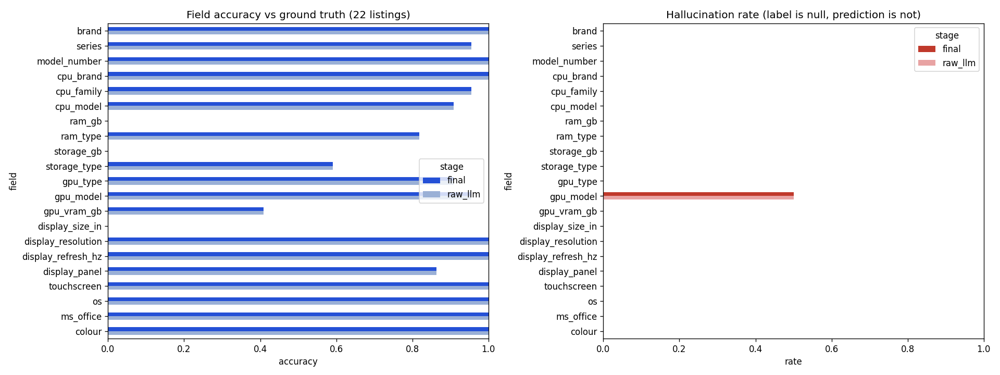
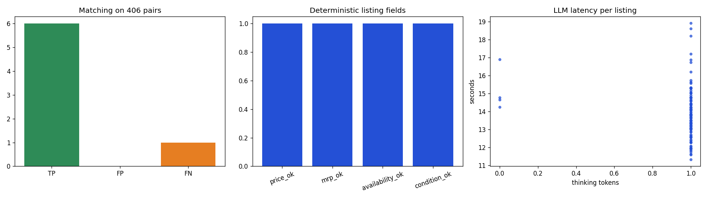
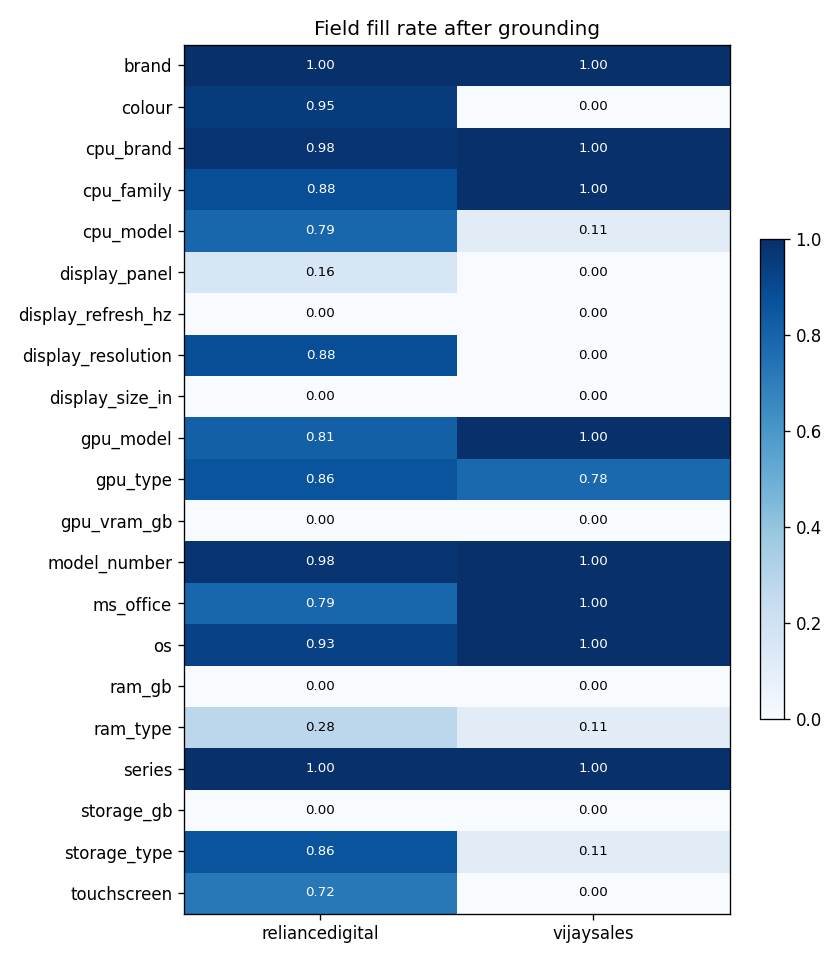

# Laptop Price and Specification Pipeline

A Kaggle notebook pipeline that collects laptop listings from two Indian retailers and HP's India store, keeps every
raw page for traceability, and turns each listing into a strict 42-field canonical record. The record covers identity,
processor with its configured power limit, memory, graphics with VRAM and TGP, display, battery, adapter, weight,
thickness, cooling, Wi-Fi and software. Values come from deterministic spec-table rules first, and the locally run
[K2 Horizon 3.7B](https://huggingface.co/IFM/K2-Horizon-3.7B) model fills the rest. The pipeline then matches identical
configurations across sellers and loads everything into SQLite with price history, per-field provenance, freshness
labels, run metrics, alerts and the lowest current comparable price per exact configuration.

A Next.js web app in [`web/`](web/) (Laptop Ledger) reads that database and presents it as a laptop marketplace:
every store's price for a laptop side by side, 42 laptop-specific filters, and a spec sheet that shows where
each value came from. See [Web app](#web-app).

Status:

- The current version (42 fields, three sources, rules, freshness, monitoring) ran end to end on Kaggle GPU T4 x2 on
  2026-10-09 (run `20261009T192530Z`, 26 minutes 55 seconds). Its outputs are in [`outputs/`](outputs/), the
  committed [`laptop-price-pipeline.ipynb`](laptop-price-pipeline.ipynb) keeps that run's cell outputs, and the
  results are in [Results of the last Kaggle run](#results-of-the-last-kaggle-run).
- Headline results on 29 hand-labelled listings (756 scored field cells): final field accuracy 0.9881, precision
  0.9949, recall 0.9752, hallucination rate 0.020; matching precision 1.0 and recall 0.857 over 406 pairs; price,
  MRP, availability and condition all correct. No health-check alert fired.
- The deterministic stages are also tested locally ([Local checks](#local-checks)): against the 29 snapshots, by
  replaying the run's 84 live pages, and with a small polite live crawl of all three sites.
- The web app runs locally against the committed database (`npm run dev`); its format, lint, type, unit test and
  build checks pass with `npm run check`.

## Table of contents

- [Quick start (Kaggle)](#quick-start-kaggle)
- [Web app](#web-app)
- [How it works](#how-it-works)
- [Sources and compliance](#sources-and-compliance)
- [Repository structure](#repository-structure)
- [Canonical laptop schema](#canonical-laptop-schema)
- [Database](#database)
- [Freshness, monitoring and recovery](#freshness-monitoring-and-recovery)
- [Configuration](#configuration)
- [Deployment and incremental runs](#deployment-and-incremental-runs)
- [Evaluation](#evaluation)
- [Results of the last Kaggle run](#results-of-the-last-kaggle-run)
- [Notebook walkthrough](#notebook-walkthrough)
- [Local checks](#local-checks)
- [Troubleshooting](#troubleshooting)
- [Known limitations](#known-limitations)
- [Research and sources](#research-and-sources)

## Quick start (Kaggle)

1. **Create or update the fixtures dataset.** On Kaggle, choose _Datasets > New Dataset_ (or _New Version_ of the
   existing one) and upload the contents of the `fixtures/` folder: `ground_truth.json` and the `snapshots/` folder,
   which now holds 29 snapshots, including 7 HP Store pages. Keep the dataset **private**.
   - The notebook finds `ground_truth.json` and `index.jsonl` anywhere under `/kaggle/input`, so a nested or flattened
     upload both work.
   - Kaggle decompresses uploaded `.gz` files. The notebook reads each snapshot as `<hash>.html.gz` or as the
     decompressed `<hash>.html`, and the SHA-256 check in `index.jsonl` still applies.
2. **Import the notebook.** _Create > New Notebook > File > Import Notebook_ and select `laptop-price-pipeline.ipynb`.
3. **Settings.**
   - Accelerator _GPU T4 x2_.
   - _Internet on_: needed for `pip install`, the model download and live scraping. Kaggle requires a phone-verified
     account for Internet.
   - _Environment_: _Always use latest environment_. An older pinned image (for example Python 3.10 with torch 2.0)
     still works, but the install cell then upgrades PyTorch to 2.6.0 (CUDA 12.4 wheels, about 2.5 GB), because
     Transformers 5.x disables PyTorch below 2.5.
   - Attach the fixtures dataset with _Add Input_.
4. **Run all.** Expected flow, with the times from the last run:

   - pinned install, hardware check (asserts 2 GPUs) and unit tests (`all deterministic unit tests passed`);
   - fixture ingestion (29 snapshots, 1.9 s);
   - live scraping of three sites in parallel. At most 80 requests per site at 6 to 8 seconds each (656.5 s);
   - model download (about 10.1 GB, 36.6 s) and load (25.8 s), then LLM normalisation (818.7 s for 113 listings),
     matching and prices;
   - evaluation, data-quality report and health checks (`All health checks passed`);
   - a final `outputs.zip` with a download link (130 files, 0.018 GB).

   The whole run took 26 minutes 55 seconds.

5. **Next runs.** _Add Input > Your Work_, then select this notebook's previous output. The run resumes from that
   database ([Deployment and incremental runs](#deployment-and-incremental-runs)).
6. **Keep it private.** Vijay Sales' terms allow personal, non-commercial use only and forbid republishing content.

Common first-run errors:

| Error                                                       | Fix                                                                                                                                                                                                   |
| ----------------------------------------------------------- | ----------------------------------------------------------------------------------------------------------------------------------------------------------------------------------------------------- |
| `AssertionError: Two GPUs are required`                     | Set the accelerator to _GPU T4 x2_.                                                                                                                                                                   |
| `Transformers cannot use torch ...` assertion               | The install cell did not upgrade PyTorch (Internet off, or torch was imported before it ran). Turn _Internet_ on, restart the session and run all again, or switch _Environment_ to the latest image. |
| `AutoModelForCausalLM requires the PyTorch library`         | Same cause as above (Transformers 5.x with torch below 2.5, as in the run on 2026-10-09); the current notebook stops earlier with the assertion above.                                                |
| `pip` or `snapshot_download` network errors                 | Turn _Internet_ on in the notebook settings.                                                                                                                                                          |
| `Fixtures dataset not found ... evaluation will be skipped` | Attach the fixtures dataset; the pipeline still runs without it.                                                                                                                                      |
| `unexpected generation prompt` assertion                    | The installed Transformers did not pass `reasoning_effort` to the chat template; check the version printed by the install cell (5.15.0 expected).                                                     |

## Web app

Laptop Ledger, in [`web/`](web/), is a Next.js app that reads the pipeline's SQLite database (read-only) and lets
users find the cheapest place to buy an exact laptop configuration.

### Quick start (web app)

Prerequisite: Node.js 22.13 or newer (the app uses the built-in `node:sqlite` module; `.nvmrc` pins 24). Run from the
repository root:

```bash
npm run dev
```

- The first run installs dependencies with `npm ci` into `node_modules/` (cache in `.cache/npm`) and creates
  `web/.env.local` from `web/.env.example`. Later runs skip the install unless `package-lock.json` changes.
- It starts `next dev` on <http://localhost:3000>, prints `[dev] Ready: ...` and opens the browser (not when `CI` is
  set). Ctrl+C stops the server and its child processes.
- It reads the committed run database `outputs/db/laptops.sqlite`, so it works without running the notebook.

Common errors:

| Message                                              | Fix                                                                                                 |
| ---------------------------------------------------- | --------------------------------------------------------------------------------------------------- |
| `Node.js 22.13 or newer is required`                 | Install Node.js 22.13+ (24 recommended).                                                            |
| `Port 3000 is in use`                                | Stop the other process, or run `PORT=3001 npm run dev` (PowerShell: `$env:PORT=3001; npm run dev`). |
| Page says "The laptop catalogue could not be loaded" | The database path is wrong. Set `LAPTOP_DB_PATH` in `web/.env.local` and restart.                   |

### Features

- **Prices from every store side by side.** Each laptop shows its headline price, MRP and discount, and its page lists
  every store's offer with stock, condition (new or store display unit), when it was last checked and a link to the
  store. "Best price" is the pipeline's lowest comparable offer from `lowest_prices` (new, in stock, checked within 7
  days, confirmed match). Otherwise the app shows the cheapest in-stock offer and says the match is unconfirmed, or
  the last seen price marked out of stock or out of date.
- **42 laptop-specific filters** in eight groups: price, stock, discount, store, condition, multi-store; brand;
  processor brand, family, cores, threads, boost clock, cache, power limit; RAM size, type, speed, upgradability,
  storage size and type; graphics type, model, video memory size and type, TGP; screen size, resolution, refresh
  rate, panel, brightness, colour gamut, touchscreen; battery capacity and cells, weight, thickness, charger, cooling;
  Wi-Fi, backlit keyboard, operating system, Microsoft Office. Filters for specs no listing states are hidden
  (processor power limit and cooling with the current data, leaving 40).
- **Budget presets.** One-click price ranges labelled in short Indian form (Under ₹50K, ₹50K – ₹80K, ₹80K – ₹1.2L,
  Over ₹1.2L) above the price slider and typed fields.
- **Spec coverage.** Filters whose spec fewer than 90% of laptops state say how many do. Laptops that do not state a filtered spec are
  excluded unless "Include laptops with missing specs" (at the end of the filter panel) is on.
- **Expand all / Collapse all** and **Clear filters** in the filter panel head, which stays in view while the filters
  scroll.
- **Counts per option** that assume the option's own filter is off, so users see what another choice would add.
- **Scannable results.** Each card lists the key specs (processor, memory, storage, graphics, display, weight) as
  labelled values, the price with MRP and discount, and the store with the lowest price. Numbered pages below.
- **Search** over names, model and part numbers, processors, GPUs and store titles (hyphens ignored).
- **Sorting** by lowest or highest price, biggest discount, lightest, largest battery, most stores; laptops that can
  be bought now come first.
- **Laptop page.** Price and store button with the key specs beside the photos, then "Where to buy" with every
  store's offer.
- **Spec sheet with provenance.** The stated fields, with the spec-table key, page data or extraction model each
  value came from, per store. A "Show N missing specs" switch reveals the remaining fields of the 42 as "Not stated".
- **Unconfirmed matches.** Laptops the pipeline queued in `match_candidates` link to each other with the reason.
- Shareable URLs: every filter, search, sort and page is a query parameter.
- Light and dark themes follow the system setting. Colours and fonts come from Apple's product pages (extracted by
  [designlang](https://github.com/Manavarya09/design-extract)); sizes, radii and spacing follow one compact token
  system for a dense tool. See [DESIGN.md](DESIGN.md).
- Accessories the pipeline picked up (a webcam and a speaker in the current database) are excluded: a laptop must
  state a processor, RAM or storage.

Design choices are in [DESIGN.md](DESIGN.md); module layout and rules are in [ARCHITECTURE.md](ARCHITECTURE.md).

### Configuration

| Variable         | Required | Purpose                                                   | Example                        | Default                        |
| ---------------- | -------- | --------------------------------------------------------- | ------------------------------ | ------------------------------ |
| `LAPTOP_DB_PATH` | Optional | Pipeline database to read, absolute or relative to `web/` | `../outputs/db/laptops.sqlite` | `../outputs/db/laptops.sqlite` |
| `PORT`           | Optional | Port for `npm run dev`                                    | `3001`                         | `3000`                         |

To show a newer Kaggle run, replace `outputs/db/laptops.sqlite` (or point `LAPTOP_DB_PATH` at the new file). The app
reloads it within 5 minutes, or at once when the file changes.

### Scripts

Run from the repository root (npm workspaces; `web/` holds the app):

| Command                | What it does                                                                         |
| ---------------------- | ------------------------------------------------------------------------------------ |
| `npm run dev`          | Install if needed, start the dev server, open the browser                            |
| `npm run build`        | Production build of `web/`                                                           |
| `npm start`            | Serve the production build                                                           |
| `npm run lint`         | ESLint with the Next.js rules                                                        |
| `npm run typecheck`    | TypeScript, no emit                                                                  |
| `npm test`             | Vitest unit tests for `web/src/catalogue` (normalisation, pricing, filters)          |
| `npm run format:check` | Prettier check (`npm run format` writes)                                             |
| `npm run check`        | All of the above in order; the same command runs in CI (`.github/workflows/web.yml`) |

### Tech stack

| Tool                  | Version     | Purpose                                                                                        |
| --------------------- | ----------- | ---------------------------------------------------------------------------------------------- |
| Next.js (App Router)  | 16.4        | Server-rendered pages; filtering runs in server components                                     |
| React                 | 19.3        | UI; client components only for interactive controls                                            |
| TypeScript            | 5.9         | Types across the domain, data and UI layers                                                    |
| `node:sqlite`         | Node 22.13+ | Read-only access to the pipeline database, no native driver                                    |
| Radix UI (`radix-ui`) | 1.7         | Accessible primitives behind the custom checkbox, switch, slider, select, accordion and drawer |
| lucide-react          | 1.55        | Icons                                                                                          |
| Vitest                | 5.0         | Unit tests                                                                                     |
| ESLint, Prettier      | 9.39, 3.9   | Linting and formatting                                                                         |

### Troubleshooting (web app)

| Problem                                     | Likely cause                                               | Diagnostic                                          | Resolution                                                     |
| ------------------------------------------- | ---------------------------------------------------------- | --------------------------------------------------- | -------------------------------------------------------------- |
| Every price says "Price may be out of date" | the database's last run is more than 7 days old            | `SELECT MAX(last_verified_at) FROM price_history`   | run the notebook again and replace the database                |
| Few "Best price" labels                     | the pipeline compared only confirmed, in-stock, new offers | `SELECT COUNT(lowest_price_inr) FROM lowest_prices` | expected; other laptops show their in-stock or last seen price |
| Product photos missing                      | the store blocked or moved the image                       | browser network tab                                 | the gallery drops failed images and shows a placeholder        |

## How it works

```mermaid
flowchart LR
  S[Sitemaps and URL lists] --> B[Polite fetcher: robots.txt, per-host rate limit, retries, conditional GET, bot-wall stop]
  F[Fixture snapshots] --> P
  B --> P[(pages + raw HTML)]
  P --> X[Site adapters: page state, JSON-LD, spec tables, prices, availability, condition]
  X --> R[Spec rules with provenance]
  R --> E[(extractions, seller_listings, price_history)]
  E --> L[K2 Horizon 3.7B on 2 x T4: rule values prefilled, constrained JSON decoding]
  L --> V[Validation, grounding, conflict checks]
  V --> M[Deterministic matching: power-limit aware]
  M --> C[(canonical_products, product_specs, match_candidates)]
  C --> O[(v_current_offers: fresh, stale, delisted)]
  O --> Q[(lowest_prices)]
  Q --> H[Evaluation, data-quality report, health checks, run metrics]
```



Division of labour:

| Step                                                                                                            | Done by                                       | Why                                                                               |
| --------------------------------------------------------------------------------------------------------------- | --------------------------------------------- | --------------------------------------------------------------------------------- |
| HTML, page state and JSON-LD parsing, prices, MRP, availability, condition, images, seller                      | deterministic code (site adapters)            | exact values exist in the page; no reason to let a model guess                    |
| Spec tables to canonical fields (cores, clocks, RAM speed, VRAM type, battery, adapter, weight, Wi-Fi and more) | deterministic rules with per-field provenance | structured data is exact and cheap; rule values are prefilled into the LLM output |
| Remaining fields from noisy text (titles, product names, descriptions)                                          | LLM                                           | wording varies across sellers and pages                                           |
| Schema validation, grounding of every value in the source text, source-conflict detection                       | deterministic code                            | enforces "never hallucinate": unsupported values become `null`                    |
| Matching, deduplication, freshness, price aggregation, alerts                                                   | deterministic code                            | auditable rules; uncertain matches are queued for review, never merged            |

Key design points:

- **Politeness.**
  - RFC 9309 `robots.txt` matching. The standard library parser ignores the `*` wildcards these sites use.
  - At least 6 seconds between requests per host, plus jitter (or the site's `Crawl-delay`), under a per-host lock.
    The three sites run in parallel threads.
  - Up to 3 retries with exponential backoff and `Retry-After`.
  - A circuit breaker after 5 consecutive failures, or at the first bot-protection page (never bypassed).
  - An honest User-Agent, a 20-hour refresh window with `If-None-Match` / `If-Modified-Since`, and a 15 MB
    response cap.
- **Provenance.**
  - Raw HTML is stored gzipped and content-addressed by SHA-256.
  - Every extraction stores the exact text the LLM saw and the rule values with their spec keys.
  - Every LLM result stores its reasoning text, raw JSON, prefilled and forced fields, schema errors, which fields
    were nulled and why, and whether each final value came from a rule or the LLM.
  - Product specs list their supporting listings per value.
- **Power limits.** `cpu_tdp_w` and `gpu_tgp_w` are critical fields.
  - They are kept only when a page states a wattage, never inferred from the component name.
  - Matching treats the same CPU or GPU at stated limits more than 1 W apart as different configurations.
  - `canonical_products.power_limits_known` says whether a product's limits are stated.
- **Model.** BF16 weights are cast to FP16, one replica per T4, with SDPA attention. A logits sanity check falls back
  to one FP32 replica split across both GPUs. `reasoning_effort="low"` uses a 512-token thinking budget, and
  truncation is recorded.
- **Constrained decoding.** Code writes every key, separator and rule-extracted value. Every other value is restricted
  to its field grammar (enum, integer, number with range-derived digits, string, `WIDTHxHEIGHT`, or `null`) by keeping
  the first top-64 token that leaves the value valid. If none fits, the KV cache is rolled back and `null` is written.
- **Restartability.** Every stage selects only pending work, keyed on content hashes and versions (`ADAPTER_VERSION`,
  `RULES_VERSION`, `PROMPT_VERSION`, `DECODER_VERSION`, model revision). Every write is an upsert, so re-running is
  idempotent and an interrupted run resumes.

## Sources and compliance

Checked on 2026-10-09 and 2026-10-10 (robots.txt and terms read for each); details and quotes in
[RESEARCH.md](RESEARCH.md).

| Source                                                          | Status                                                             | Data                                                                |
| --------------------------------------------------------------- | ------------------------------------------------------------------ | ------------------------------------------------------------------- |
| Reliance Digital                                                | used                                                               | full spec table in the page state, price, MRP, availability, seller |
| Vijay Sales                                                     | used (server-rendered data only)                                   | JSON-LD, title, keywords, price attributes; no spec table           |
| HP Store India                                                  | used, low volume (its policy forbids high-volume automated access) | full spec table, sale price, MRP, stock label, product number       |
| Flipkart, Amazon.in, Apple, ASUS, Intel, NVIDIA, Dell, Poorvika | not used                                                           | terms forbid robots, scraping, downloading or storing content       |
| Croma, Lenovo, MSI, JioMart, PrimeABGB                          | not used                                                           | HTTP 403 or bot walls (never bypassed)                              |
| Tata CLiQ, Lenovo PSREF                                         | not used                                                           | data only through internal APIs                                     |
| Benchmark sites                                                 | not used                                                           | no permitted source of measured performance found                   |

No retailer or affiliate API credentials are configured; the code has no API adapters.

## Repository structure

```text
.
|-- laptop-price-pipeline.ipynb   The deliverable: the whole pipeline in one Kaggle notebook (64 cells), saved with
|                                 the cell outputs of run 20261009T192530Z
|-- fixtures/                     Upload as a private Kaggle dataset
|   |-- ground_truth.json         Hand-verified labels: 29 listings, 7 same-product pairs, label conventions
|   `-- snapshots/
|       |-- index.jsonl           URL, fetch time (UTC), HTTP status, SHA-256 and file name per snapshot
|       `-- <hash>.html.gz        29 real product pages (13 Reliance Digital, 9 Vijay Sales, 7 HP Store India)
|-- outputs/                      Download of Kaggle run 20261009T192530Z
|   |-- db/laptops.sqlite         The run's database, 2.9 MB (attach the run's output on Kaggle to resume from it)
|   |-- metrics/                  evaluation.json, run_summary.json, health.json, model_interface.json, three CSVs
|   |-- plots/                    extraction_accuracy.png, matching_price_latency.png, field_fill_rate.png
|   |-- reports/                  data_quality.md, lowest_prices.csv, review_queue.csv
|   |-- logs/pipeline.log         Stage timings, discovery counts and fetch warnings
|   |-- schema/laptop_schema.json Canonical JSON Schema (version 2.0)
|   `-- raw_html/<site>/          113 gzipped pages (29 fixture, 84 live): 31 HP Store, 43 Reliance
|                                 Digital, 39 Vijay Sales
|-- web/                          Laptop Ledger, the Next.js web app (see Web app and ARCHITECTURE.md)
|   |-- src/app/                  Routes: browse page, laptop page, layout, not-found, error
|   |-- src/data/catalogue.ts     Read-only SQLite access and the cached catalogue
|   |-- src/catalogue/            Pure logic: specs, normalisation, pricing, filters, URL state, tests
|   |-- src/components/           ui/ controls, browse/ and laptop/ page pieces
|   `-- .env.example              LAPTOP_DB_PATH
|-- scripts/dev.mjs               The `npm run dev` launcher
|-- package.json                  npm workspace root and scripts; package-lock.json is the lockfile
|-- .github/workflows/web.yml     CI: npm ci and npm run check
|-- ARCHITECTURE.md               Module map, dependency rules, decisions
|-- DESIGN.md                     Web app palette, type, layout, components, copy
|-- RESEARCH.md                   Dated research: model interface, source access, robots.txt and terms
|-- README.md                     This file
`-- .gitignore                    Ignores .venv/, .cache/, .agent-local/, Node and Next.js build output, caches and
                                  debug logs, SQLite journals, *.zip, secrets, editor files and the duplicate
                                  outputs/__notebook__.ipynb
```

`.agent-local/` (ignored by Git) holds the helper scripts used to build and test the notebook; see
[Local checks](#local-checks).

## Canonical laptop schema

Version 2.0 is defined once in the notebook (section 3) and exported to `schema/laptop_schema.json` (JSON Schema draft
2020-12). Every field is nullable; `null` means the listing does not state it. Critical fields define an exact
configuration for matching.

| Group                 | Fields (critical in bold)                                                                                                                                                 |
| --------------------- | ------------------------------------------------------------------------------------------------------------------------------------------------------------------------- |
| Identity              | **`brand`**, `series`, **`model_number`** (manufacturer model code), **`part_number`** (product number such as `DL5J5PA#ACJ`)                                             |
| Processor             | **`cpu_brand`**, **`cpu_family`**, **`cpu_model`**, `cpu_cores`, `cpu_threads`, `cpu_base_ghz`, `cpu_boost_ghz`, `cpu_cache_mb`, **`cpu_tdp_w`** (configured power limit) |
| Memory and storage    | **`ram_gb`**, `ram_type`, `ram_speed_mts`, `ram_max_gb`, **`storage_gb`** (1 TB = 1024 GB), `storage_type`                                                                |
| Graphics              | **`gpu_type`**, **`gpu_model`**, **`gpu_vram_gb`**, `gpu_vram_type`, **`gpu_tgp_w`** (graphics power incl. Dynamic Boost)                                                 |
| Display               | **`display_size_in`**, `display_resolution` (`WIDTHxHEIGHT`), `display_refresh_hz`, `display_panel`, `display_brightness_nits`, `display_color_gamut`, `touchscreen`      |
| Power and physical    | `battery_wh`, `battery_cells`, `adapter_w`, `weight_kg` (device only, never package or net weight), `thickness_mm`, `cooling`                                             |
| Features and software | `wifi_standard`, `backlit_keyboard`, `os`, `ms_office` (a trial or "sold separately" is not bundled), `colour`                                                            |

Ranges, enums and descriptions are in the notebook's schema table. Listing-level facts (price, MRP, availability,
condition, seller, images, URL) are extracted deterministically and stored in the listing and price tables. Measured
performance (benchmarks, sustained clocks, temperatures) has its own `benchmarks` table keyed by product and power
mode; it is empty because no permitted source was found.

## Database

`/kaggle/working/db/laptops.sqlite` (SQLite, standard library). `PRAGMA user_version` holds the schema version (2).

| Table                               | Contents                                                                                                                                                                     |
| ----------------------------------- | ---------------------------------------------------------------------------------------------------------------------------------------------------------------------------- |
| `scrape_runs`                       | run id, start and finish time, status (`finished` or `finished_with_alerts`), configuration snapshot                                                                         |
| `sites`                             | base URL, default seller, robots and terms note per site                                                                                                                     |
| `fetch_log`                         | every request: URL, time, HTTP status, outcome, error, duration, final URL after redirects                                                                                   |
| `pages`                             | one row per distinct content of a URL: SHA-256, raw HTML path, first and last fetch time, source (`live` or `fixture`)                                                       |
| `extractions`                       | adapter payload per page and adapter version, source conflicts, exact LLM input text and hash, rule values with provenance                                                   |
| `seller_listings`                   | one row per `site:product_id`: URL, seller, condition, images, conflicts, product, match status, delisting time and reason                                                   |
| `price_history`                     | one observation per listing and page version: price, MRP, availability, raw signals, last verified time                                                                      |
| `llm_normalisations`                | per unique input text, model revision, prompt, decoder and rules version: status, attempts, reasoning, prefilled and forced fields, raw and validated JSON, per-field origin |
| `canonical_products`                | matched products, match status and `power_limits_known`                                                                                                                      |
| `product_specs`                     | consolidated 42-field specification per product, per-field supporting listings and origin, `specs_verified_at`                                                               |
| `match_candidates`                  | uncertain matches waiting for review                                                                                                                                         |
| `match_reviews`                     | human decisions (`same` or `different`), applied on the next matching run                                                                                                    |
| `lowest_prices`                     | lowest current comparable price, seller, direct URL, verification time, price age in hours, number of stale offers                                                           |
| `benchmarks`                        | measured performance per product and power mode, with source and date (empty)                                                                                                |
| `failures`, `run_metrics`, `alerts` | logged failures by stage, per-stage metrics of every run, health-check alerts                                                                                                |

Views:

- `v_latest_offer`: each listing's most recently verified page version. A page that reverts to earlier content becomes
  current again; this fixes an earlier ordering by first fetch time.
- `v_current_offers`: that offer with its listing and a `fresh` / `stale` / `delisted` label.
- `v_price_timeline`: every observation and re-verification.

To confirm an uncertain match, insert a row into `match_reviews` and re-run the matching and price cells:

```sql
INSERT INTO match_reviews VALUES ('reliancedigital:10328980', 'reliancedigital:10328981', 'different', 'your-name', datetime('now'));
```

## Freshness, monitoring and recovery

- **Freshness.** An offer verified more than `PRICE_FRESHNESS_DAYS` (7) ago is `stale` and never used as a current
  price. A 404/410, or a redirect away from product pages, marks a listing `delisted`. Lowest prices carry their age in
  hours. Each run refreshes known listings oldest-verified first.
- **Monitoring.** Each run records stage times and counts in `run_metrics`. Threshold checks write `alerts` and
  `metrics/health.json`:
  - fetch error rate per site, bot-protection pages and empty discovery;
  - extraction failure rate per site, missing prices and stale share;
  - LLM failure rate and truncation rate.
- **Recovery.** A failed site or page never stops the run. Stages are idempotent. A schema upgrade migrates an older
  database: it adds the new columns and rebuilds the derived tables, keeping raw data and review decisions. A corrupt
  resumed database fails its integrity check and is set aside.

## Configuration

All settings are constants in the configuration cell (section 2); there are no environment variables or secrets.

| Setting                                                                                    | Default                                        | Purpose                                                                      |
| ------------------------------------------------------------------------------------------ | ---------------------------------------------- | ---------------------------------------------------------------------------- |
| `RESUME_FROM_PREVIOUS_RUN`                                                                 | `True`                                         | start from a previous run's database attached under `/kaggle/input`          |
| `ENABLE_LIVE_SCRAPE`                                                                       | `True`                                         | turn live scraping off to work from fixtures (and the resumed database) only |
| `SITES_ENABLED`                                                                            | `["reliancedigital", "vijaysales", "hpstore"]` | sites to scrape                                                              |
| `MAX_NEW_PRODUCT_URLS_PER_SITE` / `MAX_FETCHES_PER_SITE`                                   | `30` / `80`                                    | volume limits per site and run                                               |
| `REFRESH_AFTER_HOURS`                                                                      | `20`                                           | skip pages fetched more recently                                             |
| `MIN_REQUEST_INTERVAL_S` / `REQUEST_JITTER_S`                                              | `6.0` / `2.0`                                  | per-host delay                                                               |
| `HTTP_MAX_RETRIES` / `HOST_FAILURE_LIMIT` / `HTTP_MAX_BYTES`                               | `3` / `5` / 15 MB                              | retries, circuit breaker, response cap                                       |
| `CONTACT`                                                                                  | `""`                                           | optional contact added to the User-Agent                                     |
| `MODEL_ID` / `MODEL_REVISION`                                                              | `IFM/K2-Horizon-3.7B` / `main`                 | pin a commit hash for exact reproducibility                                  |
| `REASONING_EFFORT` / `REASONING_BUDGET_TOKENS`                                             | `low` / `512`                                  | thinking depth and cap                                                       |
| `LLM_TOPK` / `LLM_MAX_ATTEMPTS`                                                            | `64` / `2`                                     | constrained decoding candidates; retries                                     |
| `LLM_INPUT_MAX_CHARS` / `MAX_LISTINGS_TO_NORMALISE`                                        | `7000` / `250`                                 | LLM input cap; LLM work cap per run                                          |
| `PRICE_FRESHNESS_DAYS`                                                                     | `7`                                            | maximum age of a current price                                               |
| `ALERT_*`                                                                                  | see the cell                                   | monitoring thresholds                                                        |
| `ADAPTER_VERSION`, `RULES_VERSION`, `PROMPT_VERSION`, `DECODER_VERSION`, `DB_USER_VERSION` | `a2`, `r1`, `p2`, `d2`, `2`                    | cache keys and schema version; bump to re-run a stage                        |

## Deployment and incremental runs

The deployment target is Kaggle. Each run is a batch, not a real-time feed:

1. Run the notebook (Save Version, _Save & Run All_).
2. For the next run, attach the previous version's output (_Add Input > Your Work_).
   - Section 2.2 copies the newest `db/laptops.sqlite` and the `raw_html/` archive, or extracts them from an attached
     `outputs.zip` (only `db/` and `raw_html/` paths are accepted), and checks integrity.
   - The run then fetches only pages that are due, re-uses every cached LLM result, and rebuilds matches and prices.
3. Repeat at the cadence you need. Prices are as fresh as the last run; anything older than 7 days is labelled
   stale.

Runs can also be started with the official Kaggle CLI (`kaggle kernels push`); that path was not tested here.

## Evaluation

`fixtures/ground_truth.json` covers 29 real listings with hand-verified labels:

- 22 retailer pages captured on 2026-10-09, labelled for the original 21 fields. They were chosen to be hard:
  - seven same-product pairs across both retailers;
  - near-identical variants: Galaxy Book5 Pro LG1IN and LG2IN, and LOQ 15IRX10 83JE01N9IN and 83JE00W0IN;
  - two pages that contradict themselves (RAM 8 GB vs 16 GB; model 15-fa2654TX vs 15-FB3364AX);
  - a "Store Display Unit", an Apple and a Chromebook listing.
- 7 HP Store pages captured on 2026-10-09/10, labelled for all 42 fields: gaming, workstation, ultrabook, business and
  budget models.

A field that is not labelled for a listing is not scored. Labels record only what each page states, and a list means
any listed value is accepted. The labels were written by an AI assistant from the snapshots and should be
spot-checked.

Metrics computed by the notebook (section 19):

- per-field accuracy, precision, recall and hallucination rate at three stages: rules alone, decoder output, and the
  final values after grounding, overall and per site;
- schema validity and the thinking-truncation and forced-field rates;
- conflict-detection precision and recall;
- pairwise matching precision and recall over all 406 pairs;
- price, MRP, availability and condition correctness.

Results:

- LLM and end-to-end metrics from the last Kaggle run: see
  [Results of the last Kaggle run](#results-of-the-last-kaggle-run).
- Deterministic results, measured locally on 2026-10-10 by `test_pure_cells.py`:

| Metric                                                                                                                                              | Value                                                  | Source               |
| --------------------------------------------------------------------------------------------------------------------------------------------------- | ------------------------------------------------------ | -------------------- |
| Adapter price, MRP, availability, condition and product id vs labels                                                                                | 29 of 29 listings correct                              | `test_pure_cells.py` |
| Rule extraction precision (non-null rule values matching a label)                                                                                   | 434 of 434                                             | `test_pure_cells.py` |
| Rule extraction coverage (stated label cells filled by rules)                                                                                       | 434 of 606 (Vijay Sales has no spec table)             | `test_pure_cells.py` |
| HP Store new fields (cores, threads, clocks, cache, RAM speed, VRAM type, brightness, gamut, battery, adapter, weight, thickness, Wi-Fi, backlight) | 7 of 7 per field                                       | `test_pure_cells.py` |
| Source conflicts vs expected                                                                                                                        | 2 expected, 2 found, 0 false                           | `test_pure_cells.py` |
| Matching driven by labelled specs                                                                                                                   | 7 true positives, 0 false positives, 0 false negatives | `test_pure_cells.py` |

## Results of the last Kaggle run

[`outputs/`](outputs/) holds the download of run `20261009T192530Z`, made with the current notebook (every code cell's
source is identical to [`laptop-price-pipeline.ipynb`](laptop-price-pipeline.ipynb)). The run started a new database
(nothing was attached to resume from).

**Environment.** Kaggle _Always use latest environment_ image: Python 3.13.15, torch 2.11.0+cu128 (new enough, so no
PyTorch upgrade), Transformers 5.15.0 (installed by the first cell), Accelerate 1.14.0, tokenizers 0.22.2, safetensors
0.8.0, huggingface-hub 1.29.0, pandas 2.3.3, matplotlib 3.10.0. Hardware: 2 x Tesla T4 (14.6 GiB each, compute
capability 7.5), 4 CPU cores, 31.3 GiB RAM, 19.5 GiB free disk. Model commit
`d6e5432c59637093c0e125e791d89ea4a0b53559`, FP16, one replica per GPU.

### Run facts

From `outputs/metrics/run_summary.json` and `outputs/logs/pipeline.log`:

| Metric                                          | Value                                                                            |
| ----------------------------------------------- | -------------------------------------------------------------------------------- |
| Pages / live pages / listings / products        | 113 / 84 / 113 / 107                                                             |
| Laptop URLs discovered                          | Reliance Digital 358, Vijay Sales 426, HP Store 81                               |
| Live fetch outcomes                             | new content: Reliance Digital 30, Vijay Sales 30, HP Store 24; HP Store errors 6 |
| Skipped as fresh (fixture URLs fetched < 20 h)  | Reliance Digital 13, Vijay Sales 9, HP Store 7                                   |
| Rule-extracted field values                     | 1,859 (mean per listing: HP Store 33.1, Reliance Digital 18.5, Vijay Sales 1.0)  |
| Auto-matched products / listings needing review | 6 (12 listings) / 4                                                              |
| Products with a lowest current price            | 56 of 107                                                                        |
| Stale offers / delisted listings                | 0 / 0                                                                            |
| Products with known power limits                | 0                                                                                |
| LLM outputs ok / failed / truncated             | 113 / 0 / 0                                                                      |
| Mean LLM latency per listing                    | 13.92 s                                                                          |
| Failures                                        | 6 (HP Store HTTP 500 on 6 OmniBook product pages, retried and logged)            |
| Alerts                                          | none (`outputs/metrics/health.json`: `"alerts": []`)                             |
| Peak GPU memory                                 | cuda:0 12.31 GiB, cuda:1 12.31 GiB (9.43 GiB each after loading)                 |
| Total run time                                  | 1,615 s (26 min 55 s)                                                            |

Stage times (seconds):

| Stage   | Fixtures | Live scrape | Extraction | Model download | Model load | Normalisation | Matching | Prices |
| ------- | -------- | ----------- | ---------- | -------------- | ---------- | ------------- | -------- | ------ |
| Seconds | 1.9      | 656.5       | 4.9        | 36.6           | 25.8       | 818.7         | 0.1      | 0.2    |

LLM normalisation by thinking mode (section 16):

| Reasoning mode                     | Listings | Mean latency (s) | Mean thinking tokens | Mean prompt tokens | Mean prefilled fields | Schema valid |
| ---------------------------------- | -------- | ---------------- | -------------------- | ------------------ | --------------------- | ------------ |
| `closed` (thinking block closed)   | 109      | 13.9             | 1.0                  | 2,217              | 17.0                  | 109          |
| `skipped` (retry without thinking) | 4        | 15.1             | 0.0                  | 1,718              | 1.0                   | 0            |

The 4 retried listings are live Vijay Sales pages (`vijaysales:218732`, `218313`, `227820`, `231497`). Both attempts
produced an out-of-range `display_size_in` (6.17 or 6.2); validation set it to `null` and kept the rest, so they still
count as `ok`.

### Evaluation on the 29 labelled listings

From `outputs/metrics/evaluation.json` (756 scored field cells per stage: rules alone, decoder output, final values
after grounding):

| Stage   | Accuracy | Precision | Recall | Hallucination rate |
| ------- | -------- | --------- | ------ | ------------------ |
| Rules   | 0.7923   | 1.0000    | 0.7162 | 0.0000             |
| Decoder | 0.9550   | 0.9504    | 0.9802 | 0.1733             |
| Final   | 0.9881   | 0.9949    | 0.9752 | 0.0200             |

Final values per site:

| Site             | Scored cells | Accuracy | Precision | Recall | Hallucination rate |
| ---------------- | ------------ | -------- | --------- | ------ | ------------------ |
| HP Store India   | 294          | 0.9932   | 0.9919    | 0.9959 | 0.0417             |
| Reliance Digital | 273          | 0.9890   | 1.0000    | 0.9600 | 0.0000             |
| Vijay Sales      | 189          | 0.9788   | 0.9924    | 0.9630 | 0.0185             |

| Other metric                                | Value                                                         |
| ------------------------------------------- | ------------------------------------------------------------- |
| Schema validity, LLM success rate           | 1.0, 1.0                                                      |
| Thinking truncated rate, forced field rate  | 0.0, 0.00082                                                  |
| Conflict detection (tp / fp / fn)           | 2 / 0 / 0: precision 1.0, recall 1.0                          |
| Matching over 406 pairs (tp / fp / fn)      | 6 / 0 / 1: precision 1.0, recall 0.857 (7 same-product pairs) |
| Price, MRP, availability, condition correct | 1.0 each                                                      |

Per-field metrics (`outputs/metrics/extraction_per_field.csv`; "Labelled" is the number of listings scored, 29 for
the original 21 fields and 7 HP pages for the 21 new ones; "-" means no listing had a `null` label for that field):

| Field                     | Labelled | Rules acc. | Decoder acc. | Final acc. | Final precision | Final recall | Decoder halluc. | Final halluc. |
| ------------------------- | -------- | ---------- | ------------ | ---------- | --------------- | ------------ | --------------- | ------------- |
| `brand`                   | 29       | 1.00       | 1.00         | 1.00       | 1.00            | 1.00         | -               | -             |
| `series`                  | 29       | 0.41       | 1.00         | 1.00       | 1.00            | 1.00         | -               | -             |
| `model_number`            | 29       | 0.69       | 0.97         | 0.97       | 1.00            | 0.93         | -               | -             |
| `part_number`             | 7        | 1.00       | 1.00         | 1.00       | 1.00            | 1.00         | -               | -             |
| `cpu_brand`               | 29       | 0.69       | 1.00         | 1.00       | 1.00            | 1.00         | -               | -             |
| `cpu_family`              | 29       | 0.62       | 0.97         | 0.97       | 1.00            | 0.97         | -               | -             |
| `cpu_model`               | 29       | 0.83       | 0.93         | 0.93       | 1.00            | 0.89         | 0.00            | 0.00          |
| `cpu_cores`               | 7        | 1.00       | 1.00         | 1.00       | 1.00            | 1.00         | -               | -             |
| `cpu_threads`             | 7        | 1.00       | 1.00         | 1.00       | 1.00            | 1.00         | -               | -             |
| `cpu_base_ghz`            | 7        | 1.00       | 0.43         | 0.71       | 0.00            | -            | 0.57            | 0.29          |
| `cpu_boost_ghz`           | 7        | 1.00       | 1.00         | 1.00       | 1.00            | 1.00         | -               | -             |
| `cpu_cache_mb`            | 7        | 1.00       | 1.00         | 1.00       | 1.00            | 1.00         | -               | -             |
| `cpu_tdp_w`               | 7        | 1.00       | 1.00         | 1.00       | -               | -            | 0.00            | 0.00          |
| `ram_gb`                  | 29       | 0.69       | 1.00         | 1.00       | 1.00            | 1.00         | -               | -             |
| `ram_type`                | 29       | 0.86       | 0.93         | 1.00       | 1.00            | 1.00         | 0.17            | 0.00          |
| `ram_speed_mts`           | 7        | 1.00       | 1.00         | 1.00       | 1.00            | 1.00         | -               | -             |
| `ram_max_gb`              | 7        | 1.00       | 1.00         | 1.00       | -               | -            | 0.00            | 0.00          |
| `storage_gb`              | 29       | 0.52       | 1.00         | 1.00       | 1.00            | 1.00         | -               | -             |
| `storage_type`            | 29       | 0.69       | 1.00         | 1.00       | 1.00            | 1.00         | -               | -             |
| `gpu_type`                | 29       | 0.28       | 0.93         | 0.93       | 1.00            | 0.90         | -               | -             |
| `gpu_model`               | 29       | 0.69       | 0.97         | 1.00       | 1.00            | 0.96         | 0.50            | 0.00          |
| `gpu_vram_gb`             | 29       | 0.83       | 0.97         | 1.00       | 1.00            | 1.00         | 0.08            | 0.00          |
| `gpu_vram_type`           | 7        | 1.00       | 1.00         | 1.00       | 1.00            | 1.00         | 0.00            | 0.00          |
| `gpu_tgp_w`               | 7        | 1.00       | 1.00         | 1.00       | -               | -            | 0.00            | 0.00          |
| `display_size_in`         | 29       | 0.69       | 1.00         | 1.00       | 1.00            | 1.00         | -               | -             |
| `display_resolution`      | 29       | 1.00       | 0.90         | 0.97       | 0.95            | 0.91         | 0.17            | 0.17          |
| `display_refresh_hz`      | 29       | 1.00       | 0.93         | 1.00       | 1.00            | 1.00         | 0.08            | 0.00          |
| `display_panel`           | 29       | 0.83       | 0.97         | 1.00       | 1.00            | 0.92         | 0.06            | 0.00          |
| `display_brightness_nits` | 7        | 1.00       | 1.00         | 1.00       | 1.00            | 1.00         | -               | -             |
| `display_color_gamut`     | 7        | 1.00       | 1.00         | 1.00       | 1.00            | 1.00         | -               | -             |
| `touchscreen`             | 29       | 1.00       | 0.59         | 1.00       | 1.00            | 1.00         | 0.75            | 0.00          |
| `battery_wh`              | 7        | 1.00       | 1.00         | 1.00       | 1.00            | 1.00         | -               | -             |
| `battery_cells`           | 7        | 1.00       | 1.00         | 1.00       | 1.00            | 1.00         | -               | -             |
| `adapter_w`               | 7        | 1.00       | 1.00         | 1.00       | 1.00            | 1.00         | -               | -             |
| `weight_kg`               | 7        | 1.00       | 1.00         | 1.00       | 1.00            | 1.00         | -               | -             |
| `thickness_mm`            | 7        | 1.00       | 1.00         | 1.00       | 1.00            | 1.00         | -               | -             |
| `cooling`                 | 7        | 1.00       | 1.00         | 1.00       | -               | -            | 0.00            | 0.00          |
| `wifi_standard`           | 7        | 1.00       | 1.00         | 1.00       | 1.00            | 1.00         | -               | -             |
| `backlit_keyboard`        | 7        | 1.00       | 1.00         | 1.00       | 1.00            | 1.00         | 0.00            | 0.00          |
| `os`                      | 29       | 0.59       | 1.00         | 1.00       | 1.00            | 1.00         | -               | -             |
| `ms_office`               | 29       | 0.69       | 0.93         | 1.00       | 1.00            | 0.89         | 1.00            | 0.00          |
| `colour`                  | 29       | 1.00       | 1.00         | 1.00       | 1.00            | 1.00         | 0.00            | 0.00          |

The 9 wrong final cells (section 19 output):

| Snapshot                   | Site             | Field                | Predicted   | Label                   |
| -------------------------- | ---------------- | -------------------- | ----------- | ----------------------- |
| `9fe25ac9e8293463.html.gz` | Reliance Digital | `cpu_model`          | `null`      | `M5` or `Apple M5`      |
| `bb080920112feb55.html.gz` | Reliance Digital | `cpu_family`         | `null`      | Intel Processor N forms |
| `bb080920112feb55.html.gz` | Reliance Digital | `cpu_model`          | `null`      | `N50` forms             |
| `1d6b4ee510c79642.html.gz` | Vijay Sales      | `display_resolution` | `1920x1080` | `null` (not stated)     |
| `d62d8799d56d2726.html.gz` | Vijay Sales      | `gpu_type`           | `null`      | `integrated`            |
| `5caecd8609b4d39c.html.gz` | Vijay Sales      | `gpu_type`           | `null`      | `integrated`            |
| `e8f3c7301d629d85.html.gz` | Vijay Sales      | `model_number`       | `null`      | `UNQN9SI003`            |
| `243d6dcb633bbdb9.html.gz` | HP Store India   | `cpu_base_ghz`       | `5.8`       | `null` (not stated)     |
| `a17e4c6b07b01e8b.html.gz` | HP Store India   | `cpu_base_ghz`       | `5.0`       | `null` (not stated)     |

The two HP errors are boost clocks reported as base clocks. The one missed match is the ASUS ROG Strix G16
G614PH-RV073WS pair (`f1d5829f6b9d1864` on Reliance Digital, `1d6b4ee510c79642` on Vijay Sales): both listings went to
review with the reason `display_resolution: 1920x1200 != 1920x1080`, because the Vijay Sales value was inferred from
"FHD" and passed grounding.



_Left: accuracy per field for rules, decoder and final values. Rules are exact where they fire but miss fields on
Vijay Sales pages and in titles; the decoder fills them, and grounding removes most of its unsupported values. Right:
hallucination rate (label is `null`, prediction is not). The decoder's highest rates are `ms_office` (1.00),
`touchscreen` (0.75), `cpu_base_ghz` (0.57) and `gpu_model` (0.50); after grounding only `cpu_base_ghz` (0.29) and
`display_resolution` (0.17) remain._



_Left: matching on 406 pairs (6 TP, 0 FP, 1 FN). Middle: price, MRP, availability and condition are correct on every
labelled listing. Right: LLM latency (about 11 to 19 s) against thinking tokens: 1 token on 109 listings and 0 on the
4 retries._

### Data quality and prices

From `outputs/reports/data_quality.md`:

| Site             | Listings | Normalised | Needs review | Offers in stock / out of stock / unknown | Spec values from rules / LLM | Missing a price |
| ---------------- | -------- | ---------- | ------------ | ---------------------------------------- | ---------------------------- | --------------- |
| HP Store India   | 31       | 31         | 0            | 22 / 4 / 5                               | 1,026 / 35                   | 1               |
| Reliance Digital | 43       | 43         | 3            | 39 / 4 / 0                               | 794 / 178                    | 1               |
| Vijay Sales      | 39       | 39         | 1            | 2 / 37 / 0                               | 39 / 444                     | 1               |

- **Match status (listings).** 12 auto-matched, 4 needs review, 90 single listing, 7 unmatched (no model number).
- **Condition.** 21 Vijay Sales offers are `display_unit` (Store Display Unit); every other offer is `new`.
- **Freshness.** All 113 current offers are `fresh` (age 0.2 to 6.5 hours at the end of the run).
- **Price signal flags.** 13 listings: 4 Reliance Digital pages whose page state says out of stock while JSON-LD says
  in stock, and 9 listings with an MRP discount above 50% (5 on HP Store, 3 on Reliance Digital, 1 on Vijay Sales).
- **Pending review.** 2 candidate pairs: the G614PH pair above (`same_model_number_incompatible_specs`) and two Vijay
  Sales listings without a model number, an Acer Nitro V and a Store Display Unit Acer ALG
  (`same_config_no_model_number`).
- **Health checks.** `All health checks passed`; no alert rows.



_Share of listings with a value per field and site after grounding. HP Store pages fill almost every field from their
spec tables; Reliance Digital fills most; Vijay Sales has no server-rendered spec table, so only title-level fields
(brand, CPU family, RAM, storage, size, GPU model, OS) are mostly filled. `cpu_tdp_w` and `cooling` are empty
everywhere, and `gpu_tgp_w` is filled on 5% of Reliance Digital listings only._

`outputs/reports/lowest_prices.csv` lists all 107 products; 56 have a lowest current comparable price. The cheapest
is the Asus ChromeBook 15 CX1505CTA-S70293 at Rs 47,990 (Reliance Digital). Each row gives the price, seller, price
age in hours, comparable offers, listings, stale offers, `power_limits_known`, verification time and direct URL.

### Other output files

| File                                   | Contents                                                                                            |
| -------------------------------------- | --------------------------------------------------------------------------------------------------- |
| `outputs/metrics/extraction_cells.csv` | 2,268 rows: every scored cell (file, site, field, group, stage, prediction, label, correctness)     |
| `outputs/metrics/matching_pairs.csv`   | 406 rows: every fixture pair with gold and predicted "same product" and both match statuses         |
| `outputs/metrics/model_interface.json` | model path, revision, library versions, vocabulary size, EOS and thinking tag ids, prompt tail      |
| `outputs/reports/review_queue.csv`     | 11 rows: the 4 `needs_review` and 7 `unmatched_no_model_number` listings with reasons and conflicts |
| `outputs/schema/laptop_schema.json`    | the canonical JSON Schema (version 2.0)                                                             |
| `outputs/db/laptops.sqlite`            | the run's database; section 2.2 resumes from it when the run's output is attached on Kaggle         |

### Changes since the previous Kaggle run

The previous run (`20261009T175113Z`, earlier the same day, 21-field notebook version) exposed defects that the
current version fixes. This run confirms the fixes:

| Defect in run `20261009T175113Z`                               | Result in run `20261009T192530Z`                                                                           |
| -------------------------------------------------------------- | ---------------------------------------------------------------------------------------------------------- |
| Every numeric value was `null` (decoder rejected a bare space) | `ram_gb`, `storage_gb` and `display_size_in` final accuracy 1.00 (was 0.00)                                |
| False RAM and model conflicts on 8 live listings               | conflict detection 2 / 0 / 0; no live listing flagged                                                      |
| Vijay Sales discovery returned no URLs from Kaggle             | 426 URLs discovered, 30 new pages fetched                                                                  |
| Duplicated names such as `HP HP 15 15-FD0901TU`                | now `HP 15 15-FD0901TU`; a non-adjacent repeat remains (`Lenovo IdeaPad Slim 3 15IRH10 Lenovo 83K1006SIN`) |
| Missed G614PH match (`GeForce RTX 50 Series` as GPU model)     | still missed, now because of the inferred `display_resolution` described above                             |

Final accuracy rose from 0.7792 (462 cells, 21 fields) to 0.9881 (756 cells, 42 fields), and the final
hallucination rate moved from 0.0098 to 0.020. Mean LLM latency rose from 9.62 s to 13.92 s per listing, with
longer prompts (2,217 tokens on average).

## Notebook walkthrough

Outputs quoted from run `20261009T192530Z`, as saved in the notebook.

| Section                  | What it does                                                                                                     | Output in the last run                                                                                                                                    |
| ------------------------ | ---------------------------------------------------------------------------------------------------------------- | --------------------------------------------------------------------------------------------------------------------------------------------------------- |
| 1 Setup                  | installs Transformers 5.15.0 (and torch 2.6.0 if older than 2.5) if needed, imports, checks GPUs, CPU, RAM, disk | `Installing: transformers==5.15.0`; versions listed above; 2 x Tesla T4 14.6 GiB, 4 CPU cores, 31.3 GiB RAM, 19.5 GiB free disk                           |
| 2 Configuration          | constants, output folders, seeds, logger, timers, run metrics; 2.2 resumes from a previous run                   | `Run 20261009T192530Z`; `Starting with a new database (no previous run attached, or resume disabled).`                                                    |
| 3 Schema                 | 42 canonical fields, validator, JSON Schema export                                                               | field table (group, field, type, critical, allowed values, range); `schema/laptop_schema.json`                                                            |
| 4 Database               | tables, views, migration, site notes, run record                                                                 | 17 tables and 3 views listed                                                                                                                              |
| 5 Fetching               | `RobotsPolicy`, bot-wall detection, `PoliteFetcher`                                                              | no output                                                                                                                                                 |
| 6-7 Parsing and adapters | price, availability, condition helpers; Reliance Digital, Vijay Sales and HP Store adapters; LLM input builder   | `Adapters: ['reliancedigital', 'vijaysales', 'hpstore']`                                                                                                  |
| 8 Checks and rules       | normalisers, grounding, conflict detection, compatibility; 8.1 spec rules; 8.2 offline unit tests                | `spec rules: 46`; `all deterministic unit tests passed`                                                                                                   |
| 9 Fixtures               | finds the dataset, reads `.html.gz` or decompressed snapshots, verifies checksums, stores them as pages          | 29 snapshots, 29 new pages, 29 labelled listings, 7 same-product pairs (1.9 s)                                                                            |
| 10 Live scraping         | sitemap discovery and incremental fetching, one thread per site, delisting                                       | discovery and fetch counts in [Run facts](#run-facts) (656.5 s)                                                                                           |
| 11 Extraction            | payloads, rule values, listings, price history                                                                   | `{'rule_fields': 1859, 'ok': 113}`; 21 Vijay Sales listings not in new condition; 2 Reliance Digital listings with conflicts; 0 delisted                  |
| 12 Model interface       | downloads the model, verifies template, thinking tags and EOS ids                                                | `metrics/model_interface.json` (36.6 s)                                                                                                                   |
| 13 Model load            | FP16 replica per GPU with logits check, FP32 fallback                                                            | `fp16 logits finite=True max\|logit\|=20.6` on both GPUs; 9.43 GiB allocated each; `Replicas: 2 \| dtype: float16`                                        |
| 14 Decoder               | constrained JSON decoder with prefill, grammar self-checks                                                       | `decoder grammar checks passed`                                                                                                                           |
| 15 Prompt                | system prompt, field list, worker with retries, post-processing with per-field origin                            | `Workers on: ['cuda:0', 'cuda:1']`                                                                                                                        |
| 16 Normalisation         | both GPUs in parallel, results written as they arrive                                                            | 113 listings, 1,859 values prefilled; `{'ok': 113, 'truncated': 0}`; mode table above (818.7 s)                                                           |
| 17 Matching              | products, consolidated specs with provenance, review candidates                                                  | 90 single, 7 unmatched without model number, 6 auto-matched products (12 listings), 4 needs review                                                        |
| 18 Prices                | lowest current comparable price per product, with age                                                            | `56 of 107 products have a comparable in-stock offer verified within 7 days; 0 stale and 0 delisted offers are excluded`                                  |
| 19 Evaluation            | extraction (rules, decoder, final), conflicts, matching, prices vs ground truth                                  | the evaluation tables above; `plots/extraction_accuracy.png`, `plots/matching_price_latency.png`; empty price-error table                                 |
| 20 Data quality          | coverage, freshness, rule vs LLM origin, conflicts, fetch outcomes, failures, fill rates; 20.1 health checks     | `reports/data_quality.md`, `reports/review_queue.csv`, `plots/field_fill_rate.png`; `All health checks passed`                                            |
| 21 Queries               | current offers per product, price timeline, spec provenance                                                      | the 6 auto-matched products with offers from both retailers; one price observation; the ROG Strix G16 G615JHR-S5005WS spec sheet with supporting listings |
| 22 Summary               | key results of the run; run metrics saved                                                                        | `metrics/run_summary.json`                                                                                                                                |
| 23 Limitations           | limitations and next steps                                                                                       | markdown only                                                                                                                                             |
| 24 Package               | zips `/kaggle/working` except caches                                                                             | `Zipped 130 files (0.018 GB) into /kaggle/working/outputs.zip`                                                                                            |

## Local checks

The notebook is never executed locally. These checks were run while building it (Python 3.11, repo-local `.venv` with
`nbformat`, `black` and `pyflakes`):

The committed notebook carries the Kaggle run's outputs. Rebuilding it from the percent-format source writes a
notebook without outputs, so rebuild only when the code changes, and replace it with the next run's download.

```bash
# Rebuild the notebook from its percent-format source (cell ids are kept in the "# %% id=..." markers)
.venv/Scripts/python .agent-local/scripts/build_notebook.py .agent-local/scripts/notebook_source.py laptop-price-pipeline.ipynb
# Static checks
.venv/Scripts/python -m pyflakes .agent-local/scripts/notebook_source.py
# Deterministic stages against the 29 fixtures (stubs out torch, pandas and plotting; no GPU)
.venv/Scripts/python .agent-local/scripts/test_pure_cells.py .agent-local/scripts/notebook_source.py .
# The same plus a small polite live crawl (fixture URLs plus 2 new URLs per site)
.venv/Scripts/python .agent-local/scripts/test_pure_cells.py .agent-local/scripts/notebook_source.py . --live 2
# The same plus a replay of the live pages stored in a downloaded Kaggle output
.venv/Scripts/python .agent-local/scripts/test_pure_cells.py .agent-local/scripts/notebook_source.py . --replay outputs
```

All three test commands ended with `ALL PURE CHECKS PASSED` (the `--replay outputs` command was last re-run on
2026-10-10 against the current outputs). Besides the results in [Evaluation](#evaluation), they check:

- the notebook's unit tests;
- the current-offer and price-timeline views;
- migration of a database built with the previous (committed) DDL;
- resume from a plain or zipped previous output, including rejection of unsafe zip paths.

On 2026-10-10 the live run completed in 142 s with the three sites in parallel:

- It discovered 358 Reliance Digital, 426 Vijay Sales and 81 HP laptop URLs.
- It fetched and extracted 5 new pages without errors. Fixture URLs fetched within 20 hours were skipped.
- One HP page returned a persistent HTTP 500, which was retried and logged.

On 2026-10-10 the replay of the 84 live pages from `outputs/` (run `20261009T192530Z`) extracted all 84 with 1,367
rule-extracted values. It found no source conflicts on live listings, and rules filled 16.3 fields per listing on
average (minimum 1, maximum 34). The fixture pass in the same command extracted 492 rule values from the 29 snapshots.

These checks test the deterministic code, not the LLM.

The web app is checked with `npm run check` (Prettier, ESLint, TypeScript, 56 Vitest tests, production build). On
2026-10-14 it was also run with `npm run dev` on Windows 11 and driven in headless Chrome at 320, 390, 820, 1440 and
1920 px in light and dark themes: no console errors or horizontal scrolling, and budget preset, drawer, chip,
search, empty state, pagination and laptop page flows behaved as expected.

## Troubleshooting

| Problem                                               | Likely cause                                      | Diagnostic                                                                                                     | Resolution                                                                                  |
| ----------------------------------------------------- | ------------------------------------------------- | -------------------------------------------------------------------------------------------------------------- | ------------------------------------------------------------------------------------------- |
| `discovered 0 laptop URLs` or `discovery failed`      | sitemap requests blocked or failing from Kaggle   | printed `Sitemap ...` warning; `alerts` row `discovery_empty`; `SELECT * FROM failures WHERE stage='discover'` | fixtures and known URLs still run; retry later, do not raise request rates                  |
| `bot_wall` outcome or alert                           | the site served a bot-protection page             | `SELECT site, url FROM fetch_log WHERE outcome='bot_wall'`                                                     | nothing to bypass; the host is skipped for the run; review whether to keep the site enabled |
| Live fetch outcomes are all `error` or `host_blocked` | the site blocks Kaggle's cloud IPs or rate-limits | `SELECT site, outcome, error, COUNT(*) FROM fetch_log GROUP BY 1,2,3`                                          | run from fixtures (`ENABLE_LIVE_SCRAPE=False`); do not raise request rates                  |
| `extraction_failure_rate` alert                       | page layout changed                               | `SELECT stage, item, error FROM failures WHERE stage='extract'`                                                | update the adapter and bump `ADAPTER_VERSION`                                               |
| `stale_offer_share` alert                             | refresh budget too small, or fetches failing      | `SELECT site, freshness, COUNT(*) FROM v_current_offers GROUP BY 1, 2`                                         | run more often or raise `MAX_FETCHES_PER_SITE` moderately                                   |
| Many `truncated` thinking results                     | 512-token budget too small                        | `SELECT reasoning_mode, COUNT(*) FROM llm_normalisations GROUP BY 1`                                           | raise `REASONING_BUDGET_TOKENS` and bump `PROMPT_VERSION`                                   |
| `FP16 produced non-finite logits` warning             | FP16 overflow                                     | printed by section 13                                                                                          | nothing to do: the notebook falls back to FP32 on both GPUs (slower)                        |
| `[fetch] ... HTTP 500` warnings for some HP pages     | HP Store server errors on those product pages     | `SELECT url, error FROM fetch_log WHERE site='hpstore' AND outcome='error'`                                    | nothing to do: the pages are retried, logged and tried again on the next run                |
| `[ERROR] cache_position is part of ... signature`     | Transformers docstring check on the model's code  | printed by section 13                                                                                          | harmless; the model loaded and ran normally in the last run                                 |
| `lowest_prices` mostly `NULL`                         | no fresh in-stock new offers with trusted matches | `SELECT match_status, COUNT(*) FROM seller_listings GROUP BY 1`                                                | refresh scraping; review `match_candidates`                                                 |
| `Previous database ... failed the integrity check`    | corrupt or partial previous output                | the warning in section 2.2                                                                                     | the run starts fresh; attach a complete previous output                                     |

## Known limitations

- **Coverage.**
  - Two retailers and one manufacturer store. Most large Indian sellers and manufacturers forbid automated access or
    sit behind bot walls, and no API credentials are configured.
  - Vijay Sales pages carry no server-rendered spec table, so several fields are `null` there.
- **Power limits and benchmarks.** No current source states CPU TDP or GPU TGP for these listings, so
  `power_limits_known` is usually 0. No permitted benchmark or thermal source was found.
- **Freshness.** Batch runs, not real time.
- **Network.** Kaggle's cloud IPs may be blocked or throttled by retailers. Vijay Sales discovery returned nothing in
  the first Kaggle run on 2026-10-09 but worked in the last run; HP Store returned HTTP 500 for 6 pages. The fixtures
  keep the pipeline and evaluation meaningful offline.
- **Model.** `reasoning_effort="low"` with a 512-token budget departs from the model card's recommendation (`high`,
  32k tokens). In the last run the model closed its thinking block after one token on 109 of 113 listings, and the
  other 4 were retried without thinking, so no reasoning was used.
- **Decoder.** The 4 retried Vijay Sales listings produced an out-of-range `display_size_in` (6.17 or 6.2), which
  validation nulled. Before grounding, the decoder's hallucination rate was 0.173.
- **Grounding.** It cannot catch a wrong value that also appears in the text, or one inferred from a stated term
  ("FHD" became `1920x1080` and blocked the G614PH match). On two HP pages the boost clock was reported as
  `cpu_base_ghz`.
- **Product names.** A non-adjacent repeated brand survives in some names
  (`Lenovo IdeaPad Slim 3 15IRH10 Lenovo 83K1006SIN`).
- **Matching.** Automatic merges need a model code or part number on both sides; colour variants are separate
  products.
- **Ground truth.** It is small, AI-labelled, and labels the new fields only on the 7 HP pages; treat metrics from it
  as indicative.

- **Web app.**
  - It shows what the pipeline stored. Spec gaps in listings stay gaps, and 51 of the 107 products have no comparable
    price in `lowest_prices` in the current database, so they show an unconfirmed or last seen price instead of
    "Best price".
  - Freshness labels depend on the current date: once the last run is more than 7 days old, every price is marked
    out of date until the notebook runs again.
  - Product photos are loaded from the stores' servers and can disappear if a store moves them.
  - Filter option labels fold seller spellings (for example "Core Ultra 7" and "Intel Core Ultra 7"); the spec sheet
    shows the stored value.

The notebook's final section lists the pipeline limitations with next steps.

## Research and sources

[RESEARCH.md](RESEARCH.md) records, with dates and sources:

- the verified model interface (files from the Hugging Face repository);
- the access review of every candidate source: robots.txt, terms quotes, where page data lives, and the decision.
