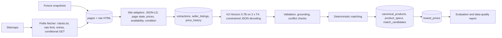

# Laptop Price Aggregation and Normalisation Pipeline

A single Kaggle notebook that scrapes laptop listings from Indian retailers, keeps the raw pages for traceability,
uses the locally run [K2 Horizon 3.7B](https://huggingface.co/IFM/K2-Horizon-3.7B) model to turn noisy listing text
into a strict canonical JSON record, matches identical configurations across sellers, and loads everything into a
SQLite database with price history and the lowest comparable price per exact configuration.

Status: the notebook has **not been run on Kaggle yet**, so it has no saved outputs and no measured metrics. The
deterministic stages (parsing, prices, conflicts, grounding, matching) were tested locally against the 22 real page
snapshots in `fixtures/`; the LLM, live scraping and GPU code paths are untested until the first Kaggle run.

## Table of contents

- [Quick start (Kaggle)](#quick-start-kaggle)
- [How it works](#how-it-works)
- [Repository structure](#repository-structure)
- [Canonical laptop schema](#canonical-laptop-schema)
- [Database](#database)
- [Configuration](#configuration)
- [Evaluation](#evaluation)
- [Notebook walkthrough](#notebook-walkthrough)
- [Local checks](#local-checks)
- [Troubleshooting](#troubleshooting)
- [Known limitations](#known-limitations)
- [Research and sources](#research-and-sources)

## Quick start (Kaggle)

1. **Create the fixtures dataset.** On Kaggle, choose _Datasets > New Dataset_, upload the contents of the `fixtures/`
   folder (`ground_truth.json` and the `snapshots/` folder), and keep it **private**. The notebook finds
   `ground_truth.json` and `index.jsonl` anywhere under `/kaggle/input`, so a nested or flattened upload both work.
   Kaggle decompresses uploaded `.gz` files; the notebook reads each snapshot as `<hash>.html.gz` or as the
   decompressed `<hash>.html`, and the SHA-256 check in `index.jsonl` still applies.
2. **Import the notebook.** _Create > New Notebook > File > Import Notebook_ and select `laptop-price-pipeline.ipynb`.
3. **Settings.** Accelerator _GPU T4 x2_; _Internet on_ (needed for `pip install`, the model download and live
   scraping; Kaggle requires a phone-verified account for Internet). Attach the fixtures dataset with _Add Input_.
4. **Run all.** Expected flow: pinned install, hardware check (asserts 2 GPUs), unit tests (`all deterministic unit
tests passed`), fixture ingestion (22 snapshots), live scraping (several minutes at about one request every 6 to 8
   seconds per site), model download (about 10.1 GB), LLM normalisation, matching, prices, evaluation, report, and a final
   `outputs.zip` with a download link.
5. **Keep it private.** Vijay Sales' terms allow personal, non-commercial use only and forbid republishing content.

Common first-run errors:

| Error                                                       | Fix                                                                                                                                               |
| ----------------------------------------------------------- | ------------------------------------------------------------------------------------------------------------------------------------------------- |
| `AssertionError: Two GPUs are required`                     | Set the accelerator to _GPU T4 x2_.                                                                                                               |
| `pip` or `snapshot_download` network errors                 | Turn _Internet_ on in the notebook settings.                                                                                                      |
| `Fixtures dataset not found ... evaluation will be skipped` | Attach the fixtures dataset; the pipeline still runs without it.                                                                                  |
| `unexpected generation prompt` assertion                    | The installed Transformers did not pass `reasoning_effort` to the chat template; check the version printed by the install cell (5.15.0 expected). |

## How it works



Division of labour:

| Step                                                                                                             | Done by                            | Why                                                                    |
| ---------------------------------------------------------------------------------------------------------------- | ---------------------------------- | ---------------------------------------------------------------------- |
| HTML and JSON-LD parsing, prices, MRP, availability, condition, images, seller                                   | deterministic code (site adapters) | exact values exist in the page; no reason to let a model guess         |
| Mapping noisy text to canonical fields (brand, series, model number, CPU, RAM, GPU, display, OS, Office, colour) | LLM                                | wording varies across sellers and pages                                |
| Schema validation, grounding of every value in the source text, source-conflict detection                        | deterministic code                 | enforces "never hallucinate": unsupported values become `null`         |
| Matching, deduplication, price aggregation                                                                       | deterministic code                 | auditable rules; uncertain matches are queued for review, never merged |

Key design points:

- **Sites.** Reliance Digital and Vijay Sales. Flipkart's terms forbid robots and page-scraping, Amazon.in is excluded on
  the same grounds, and Croma returns HTTP 403 even for `robots.txt`. Details in [RESEARCH.md](RESEARCH.md).
- **Politeness.** RFC 9309 `robots.txt` matching (the standard library parser ignores the `*` wildcards these sites
  use), at least 6 seconds between requests per host plus jitter (or the site's `Crawl-delay`), at most 3 retries with
  exponential backoff and `Retry-After`, a circuit breaker after 5 consecutive failures, an honest User-Agent, and a
  20-hour refresh window with `If-None-Match` / `If-Modified-Since`.
- **Provenance.** Raw HTML is stored gzipped and content-addressed by SHA-256; every extraction stores the exact text
  the LLM saw; every LLM result stores its reasoning text, raw JSON, schema errors and which fields were nulled and why.
- **Model.** BF16 weights cast to FP16, one replica per T4, SDPA attention. A logits sanity check falls back to one FP32
  replica split across both GPUs. `reasoning_effort="low"` with a 512-token thinking budget; truncation is recorded.
- **Constrained decoding.** Code writes every key and separator; each value is restricted to its field grammar (enum,
  integer, number, string, `WIDTHxHEIGHT`, or `null`) by keeping the first top-64 token that leaves the value valid.
  If none fits, the KV cache is rolled back and `null` is written. Output is always parseable JSON with the exact keys.
- **Restartability.** Every stage selects only pending work keyed on content hashes and versions
  (`ADAPTER_VERSION`, `PROMPT_VERSION`, `DECODER_VERSION`), and every write is an upsert, so re-running is idempotent
  and an interrupted run resumes. Identical LLM inputs are normalised once, so a price change does not trigger a new
  LLM call.

## Repository structure

```text
.
|-- laptop-price-pipeline.ipynb   The deliverable: the whole pipeline in one Kaggle notebook (58 cells)
|-- fixtures/                     Upload as a private Kaggle dataset
|   |-- ground_truth.json         Hand-verified labels for 22 listings and 7 same-product pairs
|   `-- snapshots/
|       |-- index.jsonl           URL, fetch time (2026-10-09 UTC), HTTP status, SHA-256 and file name per snapshot
|       `-- <hash>.html.gz        22 real product pages (13 Reliance Digital, 9 Vijay Sales)
|-- RESEARCH.md                   Dated research: model interface, site access, robots.txt and terms
|-- README.md                     This file
`-- .gitignore                    Ignores .venv/, .cache/, .agent-local/ and downloaded outputs
```

`.agent-local/` (ignored by Git) holds the helper scripts used to build and test the notebook; see
[Local checks](#local-checks).

## Canonical laptop schema

Defined once in the notebook (section 3) and exported to `schema/laptop_schema.json` (JSON Schema draft 2020-12).
Every field is nullable; `null` means the listing does not state it. Critical fields define an exact configuration.

| Field                | Type   | Critical | Notes                                                                                      |
| -------------------- | ------ | -------- | ------------------------------------------------------------------------------------------ |
| `brand`              | string | yes      |                                                                                            |
| `series`             | string |          | product line without model code                                                            |
| `model_number`       | string | yes      | manufacturer model or part number, never the retailer SKU                                  |
| `cpu_brand`          | enum   | yes      | Intel, AMD, Apple, Qualcomm, MediaTek                                                      |
| `cpu_family`         | string | yes      | for example Core i7, Core Ultra 5, Ryzen 9                                                 |
| `cpu_model`          | string | yes      | only when a full model number is stated                                                    |
| `ram_gb`             | int    | yes      | 1 to 256                                                                                   |
| `ram_type`           | enum   |          | DDR4, DDR5, LPDDR4X, LPDDR5, LPDDR5X                                                       |
| `storage_gb`         | int    | yes      | 1 TB = 1024 GB                                                                             |
| `storage_type`       | enum   |          | SSD, HDD, eMMC, UFS                                                                        |
| `gpu_type`           | enum   | yes      | integrated, dedicated                                                                      |
| `gpu_model`          | string | yes      |                                                                                            |
| `gpu_vram_gb`        | int    | yes      |                                                                                            |
| `display_size_in`    | number | yes      | inches                                                                                     |
| `display_resolution` | string |          | `WIDTHxHEIGHT`                                                                             |
| `display_refresh_hz` | int    |          |                                                                                            |
| `display_panel`      | enum   |          | IPS, OLED, Mini-LED, TN, VA, LCD                                                           |
| `touchscreen`        | bool   |          |                                                                                            |
| `os`                 | enum   |          | Windows 11 Home, Windows 11 Pro, Windows 11, Windows 10, macOS, ChromeOS, Linux, DOS, None |
| `ms_office`          | bool   |          |                                                                                            |
| `colour`             | string |          |                                                                                            |

Weight is deliberately excluded: Reliance Digital's "Net Weight" is the packed weight (3.26 kg for a MacBook Air).
Listing-level facts (price, MRP, availability, condition, seller, images, URL) are extracted deterministically and
stored in the listing and price tables.

## Database

`/kaggle/working/db/laptops.sqlite` (SQLite, standard library).

| Table                | Contents                                                                                                               |
| -------------------- | ---------------------------------------------------------------------------------------------------------------------- |
| `scrape_runs`        | run id, start and finish time, configuration snapshot                                                                  |
| `sites`              | base URL, default seller, robots and terms note per site                                                               |
| `fetch_log`          | every request: URL, time, HTTP status, outcome, error, duration                                                        |
| `pages`              | one row per distinct content of a URL: SHA-256, raw HTML path, first and last fetch time, source (`live` or `fixture`) |
| `extractions`        | adapter payload per page and adapter version, source conflicts, exact LLM input text and hash                          |
| `seller_listings`    | one row per `site:product_id`: URL, seller, condition, images, conflicts, product and match status                     |
| `price_history`      | one observation per listing and page version: price, MRP, availability, raw signals, last verified time                |
| `llm_normalisations` | per unique input text, model, prompt and decoder version: status, attempts, reasoning, raw and validated JSON          |
| `canonical_products` | matched products and their match status                                                                                |
| `product_specs`      | consolidated specification per product with per-field supporting listings                                              |
| `match_candidates`   | uncertain matches waiting for review                                                                                   |
| `match_reviews`      | human decisions (`same` or `different`), applied on the next matching run                                              |
| `lowest_prices`      | lowest comparable price, seller, direct URL and verification time per product                                          |
| `failures`           | every logged failure by stage                                                                                          |

`v_latest_offer` is a view with the newest observation per listing. An offer is comparable only if the listing's match
is trusted (`auto_matched`, `single_listing` or `reviewed_same`), the condition is `new`, it is `in_stock` with a valid
price, and it was verified within 7 days.

To confirm an uncertain match, insert a row into `match_reviews` and re-run the matching and price cells:

```sql
INSERT INTO match_reviews VALUES ('reliancedigital:10328980', 'reliancedigital:10328981', 'different', 'your-name', datetime('now'));
```

## Configuration

All settings are constants in the configuration cell (section 2); there are no environment variables or secrets.

| Setting                                                  | Default                             | Purpose                                           |
| -------------------------------------------------------- | ----------------------------------- | ------------------------------------------------- |
| `ENABLE_LIVE_SCRAPE`                                     | `True`                              | turn live scraping off to work from fixtures only |
| `SITES_ENABLED`                                          | `["reliancedigital", "vijaysales"]` | sites to scrape                                   |
| `MAX_NEW_PRODUCT_URLS_PER_SITE` / `MAX_FETCHES_PER_SITE` | `30` / `80`                         | volume limits per run                             |
| `REFRESH_AFTER_HOURS`                                    | `20`                                | skip pages fetched more recently                  |
| `MIN_REQUEST_INTERVAL_S` / `REQUEST_JITTER_S`            | `6.0` / `2.0`                       | per-host delay                                    |
| `HTTP_MAX_RETRIES` / `HOST_FAILURE_LIMIT`                | `3` / `5`                           | retries and circuit breaker                       |
| `CONTACT`                                                | `""`                                | optional contact added to the User-Agent          |
| `MODEL_ID` / `MODEL_REVISION`                            | `IFM/K2-Horizon-3.7B` / `main`      | pin a commit hash for exact reproducibility       |
| `REASONING_EFFORT` / `REASONING_BUDGET_TOKENS`           | `low` / `512`                       | thinking depth and cap                            |
| `LLM_TOPK` / `LLM_MAX_ATTEMPTS`                          | `64` / `2`                          | constrained decoding candidates; retries          |
| `MAX_LISTINGS_TO_NORMALISE`                              | `200`                               | LLM work cap per run                              |
| `PRICE_FRESHNESS_DAYS`                                   | `7`                                 | maximum age of a comparable price                 |

## Evaluation

The ground truth in `fixtures/ground_truth.json` covers 22 real listings captured on 2026-10-09, chosen to be hard:
seven same-product pairs across both sites, near-identical variants (Galaxy Book5 Pro LG1IN and LG2IN, LOQ 15IRX10
83JE01N9IN and 83JE00W0IN), two pages that contradict themselves (RAM 8 GB vs 16 GB; model 15-fa2654TX vs
15-FB3364AX), a "Store Display Unit", an Apple and a Chromebook listing. Labels record only what each page states; a
list means any listed value is accepted. The labels were written by an AI assistant from the snapshots and should be
spot-checked.

Metrics computed by the notebook (section 19): per-field accuracy, precision, recall and hallucination rate before and
after grounding; schema validity; thinking-truncation and forced-field rates; conflict-detection precision and recall;
pairwise matching precision and recall over all 231 pairs; and price, MRP, availability and condition correctness.

Results: Not measured in the current repository (the notebook has not been run on Kaggle).

## Notebook walkthrough

| Section                  | What it does                                                                                            | Main outputs                                                                                                    |
| ------------------------ | ------------------------------------------------------------------------------------------------------- | --------------------------------------------------------------------------------------------------------------- |
| 1 Setup                  | installs Transformers 5.15.0 if needed, imports, checks GPUs, CPU, RAM, disk                            | printed versions and hardware                                                                                   |
| 2 Configuration          | constants, output folders, seeds, logger, timers                                                        | `logs/pipeline.log`                                                                                             |
| 3 Schema                 | canonical fields, validator, JSON Schema export                                                         | `schema/laptop_schema.json`                                                                                     |
| 4 Database               | tables, view, site notes, run record                                                                    | `db/laptops.sqlite`                                                                                             |
| 5 Fetching               | `RobotsPolicy` and `PoliteFetcher`                                                                      |                                                                                                                 |
| 6-7 Parsing and adapters | price, availability, condition helpers; Reliance Digital and Vijay Sales adapters; LLM input builder    |                                                                                                                 |
| 8 Checks                 | normalisers, grounding, conflict detection, compatibility; offline unit tests                           | `all deterministic unit tests passed`                                                                           |
| 9 Fixtures               | finds the dataset, reads `.html.gz` or decompressed snapshots, verifies checksums, stores them as pages | 22 fixture pages                                                                                                |
| 10 Live scraping         | sitemap discovery and incremental fetching                                                              | `fetch_log`, outcome table per site                                                                             |
| 11 Extraction            | payloads, listings, price history                                                                       | listing counts per site                                                                                         |
| 12 Model interface       | downloads the model, verifies template, thinking tags and EOS ids                                       | `metrics/model_interface.json`                                                                                  |
| 13 Model load            | FP16 replica per GPU with logits check, FP32 fallback                                                   | memory per GPU                                                                                                  |
| 14 Decoder               | constrained JSON decoder and grammar self-checks                                                        | `decoder grammar checks passed`                                                                                 |
| 15 Prompt                | system prompt, field list, worker with retries, post-processing                                         |                                                                                                                 |
| 16 Normalisation         | both GPUs in parallel, results written as they arrive                                                   | status and latency table                                                                                        |
| 17 Matching              | products, consolidated specs, review candidates                                                         | match status table                                                                                              |
| 18 Prices                | lowest comparable price per product                                                                     | `reports/lowest_prices.csv`                                                                                     |
| 19 Evaluation            | extraction, conflicts, matching, prices vs ground truth                                                 | `metrics/evaluation.json`, `metrics/*.csv`, `plots/extraction_accuracy.png`, `plots/matching_price_latency.png` |
| 20 Data quality          | coverage, conflicts, fetch outcomes, failures, fill rates                                               | `reports/data_quality.md`, `reports/review_queue.csv`, `plots/field_fill_rate.png`                              |
| 21 Queries               | offers per product, price history, spec provenance                                                      |                                                                                                                 |
| 22 Summary               | key results of the run                                                                                  | `metrics/run_summary.json`                                                                                      |
| 23 Limitations           | limitations and next steps                                                                              |                                                                                                                 |
| 24 Package               | zips `/kaggle/working` except caches                                                                    | `outputs.zip`                                                                                                   |

## Local checks

The notebook is never executed locally. These checks were run while building it (Python 3.11, repo-local `.venv` with
`nbformat` and `pyflakes` only):

```bash
# Rebuild the notebook from its percent-format source
.venv/Scripts/python .agent-local/scripts/build_notebook.py .agent-local/scripts/notebook_source.py laptop-price-pipeline.ipynb
# Static checks
.venv/Scripts/python -m pyflakes .agent-local/scripts/notebook_source.py
# Deterministic stages against the 22 fixtures (stubs out torch, pandas and plotting; no network or GPU)
.venv/Scripts/python .agent-local/scripts/test_pure_cells.py .agent-local/scripts/notebook_source.py .
```

The last command ends with `ALL PURE CHECKS PASSED`: for all 22 snapshots the adapters reproduce the labelled price,
MRP, availability and condition; both expected source conflicts are detected with no false conflicts; grounding keeps
an accepted label for every field; and matching driven by the labelled specs gives 7 true positives, 0 false
positives and 0 false negatives. This tests the deterministic rules, not the LLM.

## Troubleshooting

| Problem                                               | Likely cause                                      | Diagnostic                                                            | Resolution                                                                 |
| ----------------------------------------------------- | ------------------------------------------------- | --------------------------------------------------------------------- | -------------------------------------------------------------------------- |
| Live fetch outcomes are all `error` or `host_blocked` | the site blocks Kaggle's cloud IPs or rate-limits | `SELECT site, outcome, error, COUNT(*) FROM fetch_log GROUP BY 1,2,3` | run from fixtures (`ENABLE_LIVE_SCRAPE=False`); do not raise request rates |
| Extraction failures after a site update               | page layout changed                               | `SELECT stage, item, error FROM failures WHERE stage='extract'`       | update the adapter and bump `ADAPTER_VERSION`                              |
| Many `truncated` thinking results                     | 512-token budget too small                        | `SELECT reasoning_mode, COUNT(*) FROM llm_normalisations GROUP BY 1`  | raise `REASONING_BUDGET_TOKENS` and bump `PROMPT_VERSION`                  |
| `FP16 produced non-finite logits` warning             | FP16 overflow                                     | printed by section 13                                                 | nothing to do: the notebook falls back to FP32 on both GPUs (slower)       |
| `lowest_prices` mostly `NULL`                         | no fresh in-stock new offers with trusted matches | `SELECT match_status, COUNT(*) FROM seller_listings GROUP BY 1`       | refresh scraping; review `match_candidates`                                |

## Known limitations

- Two retailers only; Vijay Sales pages carry no server-rendered spec table, so several fields are `null` there.
- Kaggle's cloud IPs may be blocked by retailers; the fixtures keep the pipeline and evaluation meaningful offline.
- `reasoning_effort="low"` with a 512-token budget departs from the model card's recommendation (`high`, 32k tokens).
- Grounding cannot catch a wrong value that also appears in the text (for example a CPU typo in a spec table).
- Automatic merges need a model number on both sides; colour variants are separate products.
- The ground truth is small and AI-labelled; treat metrics from it as indicative.

The notebook's final section lists these with next steps.

## Research and sources

[RESEARCH.md](RESEARCH.md) records, with dates and sources, the verified model interface (files from the Hugging Face
repository) and the access review of each retailer (robots.txt, terms, where page data lives).
